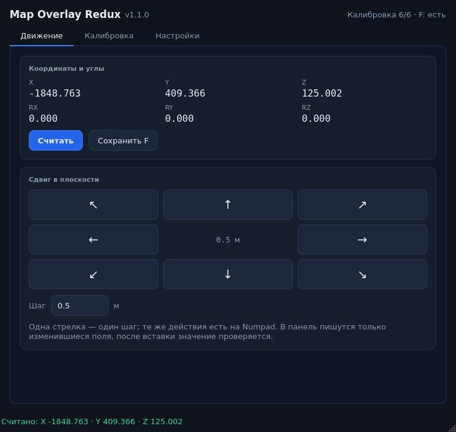

# Map Overlay Redux

Оверлей для мапперов LSP (FiveM): читает координаты предмета из игровой панели,
двигает их стрелками по восьми направлениям и вставляет обратно.



Ещё экраны: [калибровка](docs/screenshot-calibration.png) и
[настройки](docs/screenshot-settings.png).

## Что умеет (версия 1.1.0)

1. **Калибровка.** Семь точек: шесть полей `X`, `Y`, `Z`, `RX`, `RY`, `RZ` и «пустое место
   панели». Оверлей отсчитывает 3 секунды, забирает позицию курсора и запоминает её в
   `config/settings.json`.
2. **Запись значений.** Клик по полю → `Ctrl+A` → `Ctrl+V`. Пишутся только изменившиеся
   поля, результат перечитывается и проверяется.
3. **Движение стрелками.** Восемь направлений с учётом поворота `RZ`; диагональ — шаг по
   прямой. Шаг от `0.01` до `100` м.
4. **«Сохранить F».** Клик в пустое место панели (чтобы поле потеряло фокус) и клавиша `F`.
5. **Numpad.** `Num 0` — «Считать», `Num 8/2/4/6` и `Num 7/9/1/3` — направления,
   `Num 5` — «Сохранить F». Любую клавишу можно переназначить.

## Правила направлений при `RZ = 0`

| Кнопка | Что происходит | Пример (шаг 5) |
| --- | --- | --- |
| Вперёд `↑` | `X` уменьшается | `1850` → `1845` |
| Назад `↓` | `X` увеличивается | `1850` → `1855` |
| Влево `←` | `Y` уменьшается | `1850` → `1845` |
| Вправо `→` | `Y` увеличивается | `1850` → `1855` |
| `↖` | `X` и `Y` уменьшаются | `1850;1850` → `1846.464;1846.464` |
| `↗` | `X` уменьшается, `Y` увеличивается | `1850;1850` → `1846.464;1853.536` |
| `↙` | `X` увеличивается, `Y` уменьшается | `1850;1850` → `1853.536;1846.464` |
| `↘` | `X` и `Y` увеличиваются | `1850;1850` → `1853.536;1853.536` |

`Z` стрелками не меняется. Углы `RX`, `RY`, `RZ` тоже не меняются.

**Диагональ — шаг по прямой.** Обе координаты меняются на `шаг / √2`, поэтому предмет
проходит ровно шаг: при шаге 5 м каждая ось сдвигается на 3.536 м, а путь по прямой — 5 м.

## Поворот `RZ`

Направления поворачиваются вместе с предметом: `+RZ` — против часовой, `−RZ` — по часовой.

Пример: предмет стоит в `X 1850, Y 1850, RZ 90°`. Нажатие «вперёд» даёт `X 1850, Y 1845`:
предмет смотрит на `−Y`, значит и «вперёд» — туда. При `RZ = −90°` то же «вперёд» даст
`Y 1855`.

Наклон `RX`/`RY` на движение пока не влияет — оверлей предупреждает об этом, если наклон
не нулевой.

## Установка и запуск

1. Установите Python 3.12 с python.org, галочка «Add python.exe to PATH».
2. Двойной клик по `run_overlay.bat`. Первый запуск занимает 1–3 минуты: создаётся
   `.venv`, ставятся PySide6 и pyperclip. Журнал установки — `logs/setup.log`.
3. Клиент игры — в режиме «окно без рамки», оверлей поверх окна.
4. Поставьте окно оверлея так, чтобы оно **не перекрывало поля панели**: клик по точке,
   закрытой оверлеем, попадёт в оверлей, а не в игру. Второй монитор или свободный угол —
   лучший вариант.

## Проверка без запуска окна

```bat
run_overlay.bat --check-only
```

Печатает версию, версию Python, путь к настройкам и сколько полей откалибровано.
Полезно, если «окно не открывается»: видно, на каком шаге всё остановилось.

## Портативность

Папку проекта можно переносить целиком. Переменная `MAP_OVERLAY_HOME` меняет место для
`config/` и `logs/` — так можно держать несколько профилей калибровки.

## Первый запуск

1. Вкладка **Калибровка** → «Задать» у поля `X` → за 3 секунды наведите курсор точно
   на поле `X` в панели LSP и не двигайте мышью → оверлей запомнит точку.
2. Повторите для `Y`, `Z`, `RX`, `RY`, `RZ` и **«Пустое место панели»** — это место, куда
   оверлей кликает перед `F` (любой свободный участок панели, не кнопка и не поле).
   Кнопка «Показать» переводит курсор в сохранённую точку — так видно, что калибровка
   не сбилась.
3. Вкладка **Движение** → «Считать»: оверлей прочитает все шесть полей.

## Как этим пользоваться

- «Считать» читает панель. Без этого шага стрелки откажутся работать: оверлей не знает,
  от каких чисел считать.
- Стрелка делает ровно один шаг: посчитала новое значение, вставила только изменившиеся
  поля, перечитала их и проверила результат.
- «Сохранить F» фиксирует текущее положение: клик в пустое место панели, затем `F`.
- Если панель не приняла число, вы увидите это в строке состояния, а не «тихий» сдвиг.
- Пока идёт обмен с панелью (доли секунды), **не двигайте мышь**: если курсор уехал
  больше чем на 4 пикселя, обмен прерывается, чтобы не кликнуть не туда.

## Горячие клавиши

| Клавиша | Действие |
| --- | --- |
| `Num 0` | Считать координаты |
| `Num 8` / `Num 2` | Вперёд / назад |
| `Num 4` / `Num 6` | Влево / вправо |
| `Num 7` / `Num 9` | Вперёд-влево / вперёд-вправо |
| `Num 1` / `Num 3` | Назад-влево / назад-вправо |
| `Num 5` | Сохранить F |

- Клавиши **забираются у игры**: Numpad не крутит камеру и не открывает меню.
- Нужен включённый **NumLock**: без него цифровой блок посылает навигационные клавиши, и
  оверлей предупредит об этом в строке состояния.
- **Переназначение:** «Настройки» → «Изменить» у действия → нажать нужную клавишу.
  `Esc` отменяет, «✕» снимает привязку. Если клавиша занята другим действием, она
  забирается у него — двух команд на одной клавише не бывает.
- Если игра запущена от администратора, запустите оверлей так же: иначе Windows не отдаст
  хуку клавиши.
- Если хук не установился, оверлей скажет об этом; кнопки в окне работают как обычно.
- Клавиши работают, пока окно оверлея открыто; после закрытия Numpad снова принадлежит
  игре.

## Настройки

- Задержки между кликом и клавишами — если панель «не успевает».
- Знаков после запятой при вставке (по умолчанию 3).
- Проверка записи после вставки (по умолчанию включена).
- Шаг по умолчанию.
- Горячие клавиши (применяются сразу, без кнопки «Сохранить»).

## Сборка .exe

Запустите `build_exe.bat` — он поставит PyInstaller в `.venv` и соберёт
`dist\MapOverlayRedux\MapOverlayRedux.exe`. Готовый exe в репозиторий не кладётся.

## Разработка

```bash
python -m venv .venv
.venv/bin/pip install -e ".[dev]"
ruff format --check . && ruff check . && mypy && pytest --cov=map_overlay --cov-report=term-missing
```

Правила проекта — `CONTRIBUTING.md`, стиль — `STYLEGUIDE.md`, решения — `docs/adr/`,
памятка по ошибкам — `docs/LESSONS.md`, исходная инструкция — `docs/instruction-code-style-and-checks.md`.

Журнал работы: `logs/overlay.log` (JSON-строки).

## Требования

- Windows 10/11, Python 3.12, игра в режиме окна без рамки.
