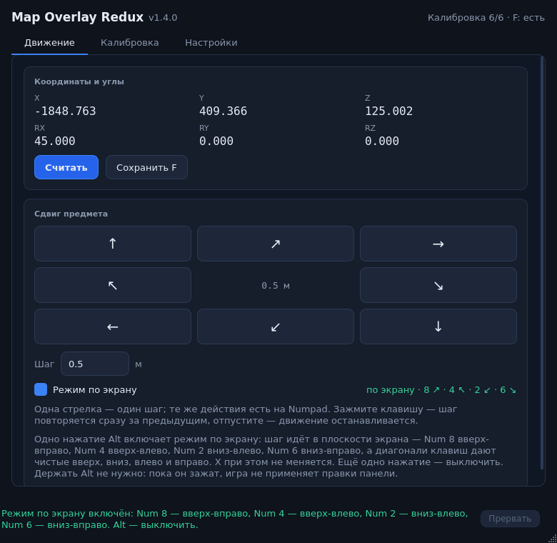

# Map Overlay Redux

Оверлей для мапперов LSP (FiveM): читает координаты предмета из игровой панели,
двигает их стрелками по восьми направлениям и вставляет обратно.


Ещё экраны: [калибровка](docs/screenshot-calibration.png) и
[настройки](docs/screenshot-settings.png).

## Что умеет (версия 1.7.0)

1. **Калибровка.** Семь точек: шесть полей `X`, `Y`, `Z`, `RX`, `RY`, `RZ` и «пустое место
   панели». Оверлей отсчитывает 3 секунды, забирает позицию курсора и запоминает её в
   `config/settings.json`.
2. **Запись значений.** Клик по полю → `Ctrl+A` → `Ctrl+V`. Пишутся только изменившиеся
   поля, результат перечитывается и проверяется.
3. **Движение стрелками.** Восемь направлений с учётом поворота `RZ`; диагонали считаются
   по случаю — без наклона в горизонтали, с наклоном по осям предмета. Шаг от `0.01` до `100` м.
   Зажатая клавиша двигает предмет без остановки, `Alt` включает режим высоты (по локальной оси `Z`, с учётом `RY`).
4. **«Сохранить F».** Клик в пустое место панели (чтобы поле потеряло фокус) и клавиша `F`.
5. **Numpad.** `Num 0` — «Считать», `Num 8/2/4/6` и `Num 7/9/1/3` — направления,
   `Num 5` — «Сохранить F». Любую клавишу можно переназначить.

## Правила направлений при `RZ = 0`

| Кнопка | Что происходит | Пример (шаг 5) |
| --- | --- | --- |
| Вперёд `↑` | `X` увеличивается | `1850` → `1855` |
| Назад `↓` | `X` уменьшается | `1850` → `1845` |
| Влево `←` | `Y` увеличивается | `1850` → `1855` |
| Вправо `→` | `Y` уменьшается | `1850` → `1845` |
| `↗` `Num 9` | без наклона — `X` в плюс, `Y` в минус | вперёд-вправо |
| `↖` `Num 7` | без наклона — `X` в плюс, `Y` в плюс | вперёд-влево |
| `↙` `Num 1` | без наклона — `X` в минус, `Y` в плюс | назад-влево |
| `↘` `Num 3` | без наклона — `X` в минус, `Y` в минус | назад-вправо |

Когда предмет наклонён (`RX ≠ 0`), диагонали считаются по осям предмета — см. «Диагонали».

`Z` у прямых клавиш (`Num 8/2/4/6`) не меняется, пока не нажат `Alt` (см. «Режим высоты»).
Углы `RX`, `RY`, `RZ` не меняются никогда.

**Диагонали — три случая, по наклону предмета.** Наклон — это `RX` (по нему же интерфейс
предупреждает о наклоне). Формулы не заменяют друг друга: каждая работает в своём случае.

| Случай | Формула | Что видно на экране |
| --- | --- | --- |
| наклона нет (`RX = 0`) | `ΔX = ax·шаг/√2`, `ΔY = ay·шаг/√2`, поворот на `RZ`, `ΔZ = 0` | обычная диагональ в горизонтали |
| наклонён только `RX` (`RY = 0`) | `ΔX = 0`, `ΔY = ay·(шаг/√2)·sin RX`, `ΔZ = ax·(шаг/√2)·cos RX` | поворот в плоскости `Y/Z`, наклон луча `90° − RX` |
| наклонены `RX` и `RY` | `ΔX = ax·шаг·sin RY`, `ΔY = ay·шаг·sin RX·cos RY`, `ΔZ = ax·шаг·cos RX·cos RY` | поворот `Rx(RX)·Ry(RY)`, `RY` уводит в глубину |

где `ax = ±1` — «вперёд/назад» (он же «вверх/вниз»), `ay = ±1` — «влево/вправо».


(схема снята при `RY = 0`, второй случай)

**Без наклона** (все четыре клавиши, шаг 0.5 м, `Num 9`):

```
ΔX = +0.354, ΔY = −0.354, ΔZ = 0
```

Диагональ поворачивается вместе с `RZ`, как и прямые клавиши.

**Наклонён только `RX = 37°`** (шаг 0.5 м):

| Клавиша | `ΔX` | `ΔY` | `ΔZ` |
| --- | --- | --- | --- |
| `Num 9` | 0 | −0.213 | +0.282 |
| `Num 7` | 0 | +0.213 | +0.282 |
| `Num 1` | 0 | +0.213 | −0.282 |
| `Num 3` | 0 | −0.213 | −0.282 |

Проверка на эталоне: `(−1849.342, 416.528, 128.826)`, `RX = 37°`, шаг `2.0` →
`X −1849.342` (не меняется), `Y 415.677`, `Z 129.955`.

**Наклонены `RX = 55°` и `RY = 17°`** (шаг 0.5 м):

| Клавиша | `ΔX` | `ΔY` | `ΔZ` |
| --- | --- | --- | --- |
| `Num 9` | +0.146 | −0.392 | +0.274 |
| `Num 7` | +0.146 | +0.392 | +0.274 |
| `Num 1` | −0.146 | +0.392 | −0.274 |
| `Num 3` | −0.146 | −0.392 | −0.274 |

Эталон: `(−1849.342, 416.528, 128.826)`, `RX = 55°`, `RY = 17°`, шаг `3.0`, `Num 9` →
`X −1848.465`, `Y 414.178`, `Z 130.472` (`Δ = +0.877, −2.350, +1.646`).

## Поворот `RZ`

Прямые направления (`Num 8/2/4/6`) поворачиваются вместе с предметом: `+RZ` — против
часовой, `−RZ` — по часовой. Диагонали без наклона поворачиваются так же; при наклоне
(`RX ≠ 0`) они считаются по осям предмета и от `RZ` не зависят.

Пример: предмет стоит в `X 1850, Y 1850, RZ 90°`. Нажатие «вперёд» даёт `X 1850, Y 1855`:
предмет смотрит на `+Y`, значит и «вперёд» — туда. При `RZ = −90°` то же «вперёд» даст
`Y 1845`.

## Режим высоты (`Alt`)

Обычные шаги идут по горизонтали и поворачиваются вместе с `RZ`. Одно нажатие `Alt`
переключает **режим высоты**: клавиши «вперёд-назад» начинают поднимать и опускать предмет,
остальные работают как обычно.



| Клавиша | Обычный режим | Режим высоты (`Alt`) |
| --- | --- | --- |
| `Num 8` | вперёд (`X` в плюс) | **вверх** по локальной оси `Z` |
| `Num 2` | назад (`X` в минус) | **вниз** по локальной оси `Z` |
| `Num 4` / `Num 6` | влево / вправо (`Y`), с поворотом `RZ` | так же — не меняются |
| `Num 7/9/1/3` | диагонали: поворот `Y/Z` на `RX` | так же — не меняются |

Пример при шаге 0.5 м: `Alt`, затем `Num 8` — `Z` +0.5, `X` и `Y` на месте; `Num 2` —
`Z` −0.5. `Num 4` в том же режиме — `Y` +0.5, `Z` без изменений.

**Шаг высоты идёт по локальной оси `Z` с учётом `RY`:**

```
ΔX = ±sin RY · шаг,   ΔY = 0,   ΔZ = ±cos RY · шаг
```

При `RY = 0` это прежний шаг строго по `Z`. Проверка на примере: `RY = 10°`, шаг `3.0` →
`ΔX +0.521, ΔZ +2.954`. Длина шага сохраняется при любом `RY` (`sin² + cos² = 1`), `Y` не
меняется, `RX` и `RZ` на высоту не влияют.


- Пока режим выключен, а предмет наклонён (`RX`/`RY` ≠ 0), оверлей напоминает в строке под
  стрелками, что `Alt` поднимает и опускает.

Режим включается одним нажатием `Alt` (или галочкой «Режим высоты» на вкладке «Движение»),
ещё одно нажатие выключает. В подписи видно, что делают клавиши: «8 ↑ вверх · 2 ↓ вниз
(ось Z, поворот RY)».

Держать `Alt` нельзя: пока он зажат, игра не применяет правки панели к объекту —
значения доходят до интерфейса и теряются. Поэтому режим и сделан переключателем.
Привычка «`Alt` + направление» сохранена: такое нажатие включает режим и делает шаг
(первый шаг может не попасть в игру, пока `Alt` зажат, — дальше всё видно).

- Режим можно переключить прямо во время удержания — следующий шаг пойдёт по-новому.

## Защита от случайного ввода

Пока оверлей работает с панелью (клик по полю, `Ctrl+A`, `Ctrl+V`), клавиатура
**заморожена**: нажатия не доходят ни до игры, ни до поля координат, `Alt` не переключает
режим. Это защищает от главной неприятности — случайная клавиша дописывает символ в поле
координат, значение перестаёт читаться, и обмен повторяется впустую.

- Перед кликом оверлей ждёт, пока будут отпущены `Alt`, `Ctrl` и `Shift` (до 1.5 с):
  с зажатым `Alt` сочетание `Ctrl+A` уходит как `Alt+Ctrl+A`.
- Собственные клавиши оверлея (`Ctrl+A`, `Ctrl+V`, `F`) заморозка пропускает — иначе он
  не смог бы записать значения.
- Чтение поля начинается с очистки буфера: если панель не отдала значение, оверлей скажет
  «Поле `X` не отдало значение», а не покажет подставленные координаты.
- Заморозка снимается сама через 20 с, даже если интерфейс её не снял.
- Если панель не ответила за 20 с, действие прерывается автоматически: окно и клавиатура
  разблокируются, в строке состояния появляется причина. Принудительно закрывать оверлей
  больше не нужно — кнопка «Прервать» тоже остаётся.
- Мышь не блокируется: «Прервать» и вкладки доступны всегда.

## Удержание направления

Зажмите клавишу направления — шаги идут один за другим, пока клавиша не отпущена.
Один шаг занимает около секунды (столько длится обмен с панелью), и следующий шаг
ставится сразу после завершения предыдущего — движение ровное, без пропусков.
У кнопок в окне удержания нет: один клик — один шаг.

- Пока панель занята, новый шаг не ставится: очередь не копится, предмет не «уезжает»
  после отпускания.
- Удержание снимается при отпускании клавиши, при нажатии другой стрелки, при «Считать»,
  «Сохранить F», «Прервать», при выключении перехвата и при ошибке панели.
- Если система не прислала отпускание (хук переставили, перехват выключили), оверлей
  проверяет, зажата ли клавиша на самом деле, и останавливается сам.

## Установка и запуск

1. Установите Python 3.12 с python.org, галочка «Add python.exe to PATH».
2. Двойной клик по `run_overlay.bat`. Первый запуск занимает 1–3 минуты: создаётся
   `.venv`, ставятся PySide6 и pyperclip. Журнал установки — `logs/setup.log`.
3. Клиент игры — в режиме «окно без рамки», оверлей поверх окна.
4. Поставьте окно оверлея так, чтобы оно **не перекрывало поля панели**: клик по точке,
   закрытой оверлеем, попадёт в оверлей, а не в игру. Второй монитор или свободный угол —
   лучший вариант.

## Проверка без запуска окна

```bat
run_overlay.bat --check-only
```

Печатает версию, версию Python, путь к настройкам и сколько полей откалибровано.
Полезно, если «окно не открывается»: видно, на каком шаге всё остановилось.

## Портативность

Папку проекта можно переносить целиком. Переменная `MAP_OVERLAY_HOME` меняет место для
`config/` и `logs/` — так можно держать несколько профилей калибровки.

## Первый запуск

1. Вкладка **Калибровка** → «Задать» у поля `X` → за 3 секунды наведите курсор точно
   на поле `X` в панели LSP и не двигайте мышью → оверлей запомнит точку.
2. Повторите для `Y`, `Z`, `RX`, `RY`, `RZ` и **«Пустое место панели»** — это место, куда
   оверлей кликает перед `F` (любой свободный участок панели, не кнопка и не поле).
   Кнопка «Показать» переводит курсор в сохранённую точку — так видно, что калибровка
   не сбилась.
3. Вкладка **Движение** → «Считать»: оверлей прочитает все шесть полей.

## Как этим пользоваться

- «Считать» читает панель. Без этого шага стрелки откажутся работать: оверлей не знает,
  от каких чисел считать.
- Стрелка делает ровно один шаг: посчитала новое значение, вставила только изменившиеся
  поля, перечитала их и проверила результат.
- «Сохранить F» фиксирует текущее положение: клик в пустое место панели, затем `F`.
- Если панель не приняла число, вы увидите это в строке состояния, а не «тихий» сдвиг.
- Если вы двинули мышь во время обмена с панелью (это доли секунды), оверлей **вернёт
  курсор в поле и продолжит** — промахнуться невозможно, клик всегда наводится на
  откалиброванную точку.

## Горячие клавиши

| Клавиша | Действие |
| --- | --- |
| `Num 0` | Считать координаты |
| `Num 8` / `Num 2` | Вперёд / назад |
| `Num 4` / `Num 6` | Влево / вправо |
| `Num 7` / `Num 9` | Вверх-влево / вверх-вправо (поворот `Y/Z`) |
| `Num 1` / `Num 3` | Вниз-влево / вниз-вправо (поворот `Y/Z`) |
| `Num 5` | Сохранить F |
| `Alt` | Включить / выключить режим высоты (`Num 8` — вверх, `Num 2` — вниз) |

Если `Alt` не переключает режим: в версии 1.3.1 исправлено, что хук клавиатуры присылает
конкретную клавишу (`0xA4` — левый `Alt`, `0xA5` — правый), а оверлей ждал общий код
`0x12`. Правый `Alt` работает так же, как левый. Пока игра перехватывает `Alt` (например,
в диалоге настройки управления), включайте режим галочкой на вкладке «Движение».

- **Зажатие:** удерживайте направление — шаги идут друг за другом, пока клавиша не отпущена.
- `Alt` сам по себе оверлей **не забирает**: он остаётся у системы и игры. Оверлей замечает
  только одиночное нажатие; `Alt+Tab`, `Alt+F4` и другие комбинации режим не переключают.
- Клавиши **забираются у игры**: Numpad не крутит камеру и не открывает меню.
- Нужен включённый **NumLock**: без него цифровой блок посылает навигационные клавиши, и
  оверлей предупредит об этом в строке состояния.
- **Переназначение:** «Настройки» → «Изменить» у действия → нажать нужную клавишу.
  `Esc` отменяет, «✕» снимает привязку. Если клавиша занята другим действием, она
  забирается у него — двух команд на одной клавише не бывает.
- Если игра запущена от администратора, запустите оверлей так же: иначе Windows не отдаст
  хуку клавиши.
- Если хук не установился, оверлей скажет об этом; кнопки в окне работают как обычно.
- Клавиши работают, пока окно оверлея открыто; после закрытия Numpad снова принадлежит
  игре.
- Оверлей показывается **без перехвата фокуса**: после запуска клавиатура остаётся у игры.
  Как только вы кликнете по окну оверлея, фокус перейдёт к нему — верните его кликом в игру.
- **Аварийный выход:** галочка «Перехватывать клавиши у игры» в «Настройках». Снимите её —
  перехват выключится сразу, игра получит все клавиши, кнопки оверлея продолжат работать.
- Не назначайте клавиши, которые нужны в игре (`W`, `A`, `S`, `D`, `Space`, `Shift`, `Ctrl`,
  `Tab`, `Esc`). Оверлей предупредит, но назначит: игра эту клавишу больше не получит.

## Настройки

- Задержки между кликом и клавишами — если панель «не успевает».
- Знаков после запятой при вставке (по умолчанию 3).
- Проверка записи после вставки (по умолчанию включена).
- Шаг по умолчанию.
- Горячие клавиши (применяются сразу, без кнопки «Сохранить»).

## Если Numpad не реагирует

Проверьте по порядку:

1. **NumLock включён.** Без него цифровой блок посылает «стрелки», и перехватывать
   нечего. Оверлей проверяет это каждые 3 секунды и пишет предупреждение в строку состояния.
2. **Нажато «Считать».** Без координат шаг не с чем складывать: в статусе и журнале будет
   «координаты не считаны».
3. **Галочка «Перехватывать клавиши у игры»** в «Настройках» — она могла остаться снятой.
4. **Оверлей не в режиме назначения клавиши** (строка состояния просит нажать клавишу) —
   в этом режиме любое нажатие создаёт привязку, а не действие.
5. **Права совпадают:** если игра запущена от администратора, запустите оверлей так же.

Теперь каждое нажатие видно в `logs/overlay.log` — три строки на одно нажатие:

```
Хук забрал клавишу Num 8          ← клавиатура дошла до оверлея
Клавиша Num 8 → Вперёд            ← событие принял интерфейс
Задача «шаг вперёд на 0.5 м» начата   ← шаг пошёл в панель
```

Что означает отсутствие строк:

| Строки в журнале | Причина |
| --- | --- |
| нет ни одной | клавиша до оверлея не дошла: NumLock, права игры или перехват выключен |
| есть только «Хук забрал клавишу» | событие потерялось в интерфейсе — пришлите журнал |
| две первые есть, третьей нет | шаг отклонён, причина рядом: «координаты не считаны», «занято другим действием», «Шаг должен быть числом» |

## Если оверлей завис

1. В строке состояния видно, сколько секунд идёт обмен с панелью. Если больше пяти —
   рядом появляется подсказка, а справа кнопка **«Прервать»**: она бросает текущее действие,
   не закрывая окно.
2. Если окно вообще не реагирует — закройте его (хук снимается, клавиатура возвращается
   игре) и запустите заново. Поза не потеряется: её нужно будет снова «Считать».
3. Пришлите два файла из папки `logs`:
   - `overlay.log` — что делал оверлей;
   - `crash.log` — падения, необработанные ошибки и стеки потоков, если интерфейс замер.

### Что теперь пишется в журналы

- каждая задача: «начата», «выполнена за N с» или «не выполнена за N с: причина»;
- ошибки панели, буфера обмена и вин32 — с текстом, а не только в строке состояния;
- необработанные исключения интерфейса и фоновых потоков — с полной трассировкой;
- при зависании интерфейса дольше 8 секунд — стеки **всех** потоков: по ним видно,
  на каком вызове всё встало.

Подробный журнал включается флагом `--debug`:

```bat
run_overlay.bat --debug
```

С ним в `overlay.log` попадают ещё и отдельные операции панели (чтение и запись каждого
поля), а записи дублируются в консоль.

## Если в игре пропала клавиатура

1. Снимите галочку **«Перехватывать клавиши у игры»** в «Настройках» — перехват
   выключается мгновенно, без перезапуска.
2. Проверьте, не назначена ли на действие клавиша из игры: `W`, `A`, `S`, `D`, `Space`,
   `Shift`, `Ctrl`, `Tab`, `Esc`.
3. Убедитесь, что окно оверлея не перекрывает места, куда вы кликаете, и что фокус у игры:
   клик по окну оверлея забирает фокус, пока вы не вернёте его кликом в игру.
4. Худший случай — закрыть окно оверлея: при закрытии хук снимается и клавиатура полностью
   возвращается игре. Мышь при этом работает всегда, поэтому выйти можно.

Запись новой привязки («Изменить») теперь сама отменяется через 10 секунд или как только
окно потеряет фокус, поэтому «вечного» перехвата не бывает.

## Сборка .exe

Запустите `build_exe.bat` — он поставит PyInstaller в `.venv` и соберёт
`dist\MapOverlayRedux\MapOverlayRedux.exe`. Готовый exe в репозиторий не кладётся.

## Разработка

```bash
python -m venv .venv
.venv/bin/pip install -e ".[dev]"
ruff format --check . && ruff check . && mypy && pytest --cov=map_overlay --cov-report=term-missing
```

Правила проекта — `CONTRIBUTING.md`, стиль — `STYLEGUIDE.md`, решения — `docs/adr/`,
памятка по ошибкам — `docs/LESSONS.md`, исходная инструкция — `docs/instruction-code-style-and-checks.md`.

Журнал работы: `logs/overlay.log` (JSON-строки).

## Требования

- Windows 10/11, Python 3.12, игра в режиме окна без рамки.
