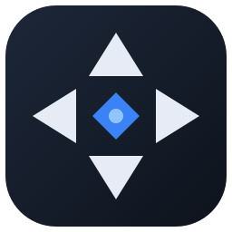
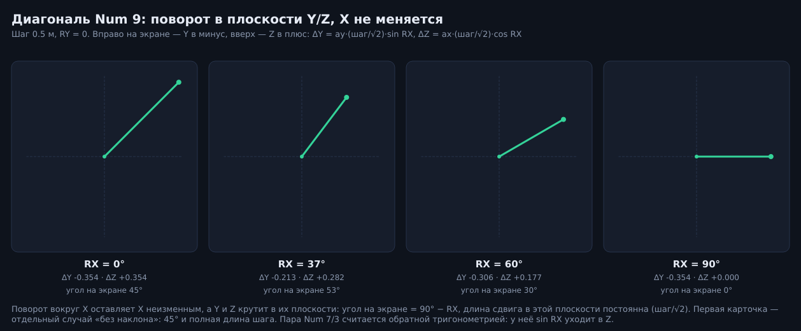
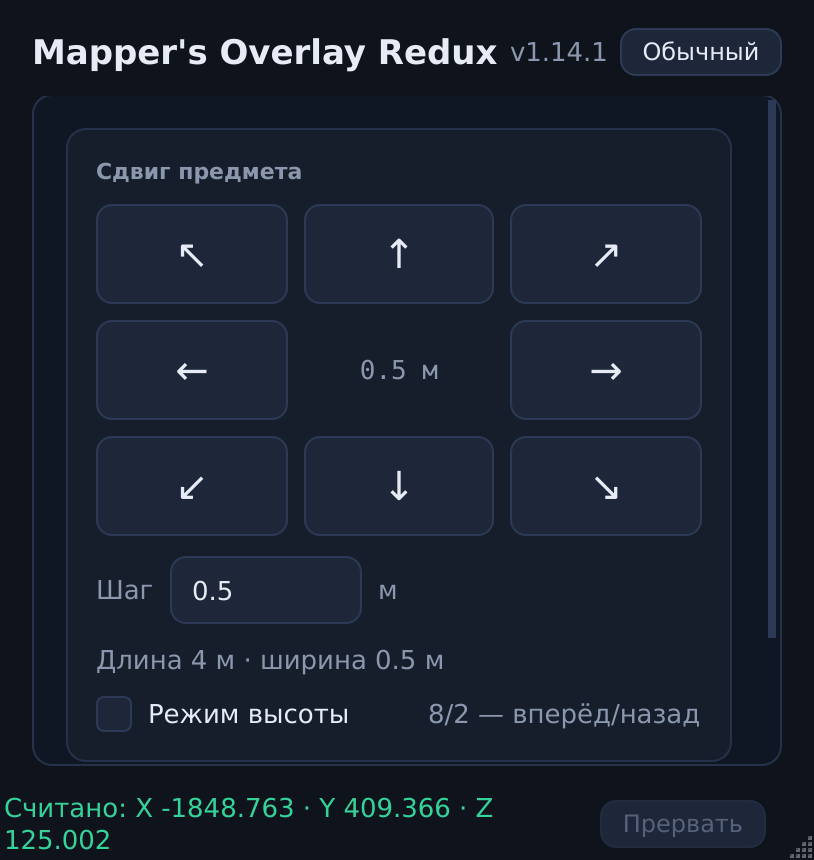

# Mapper's Overlay Redux

Оверлей для мапперов LSP (FiveM). Читает позу предмета из игровой панели, двигает её
клавишами Numpad по восьми направлениям с шагом от `0.01` до `100` м, учитывает поворот и
наклон предмета и вписывает обратно только изменившиеся поля. Версия — 1.14.1, история
изменений — `CHANGELOG.md`.


Ещё экраны: [Размеры](docs/screenshot-sizes.png) · [Калибровка](docs/screenshot-calibration.png) ·
[Настройки](docs/screenshot-settings.png) · [Мини-версия](docs/screenshot-mini.png).

## Что нужно

- Windows 10/11 и Python 3.12 с python.org (при установке — галочка «Add python.exe to PATH»).
- Игра в режиме **окно без рамки**.
- Включённый **NumLock**: без него цифровой блок посылает навигационные клавиши.

## Установка и первый запуск

1. Двойной клик по `run_overlay.bat`. Первый запуск занимает 1–3 минуты: создаётся `.venv`,
   ставятся PySide6 и pyperclip. Журнал установки — `logs/setup.log`.
2. Поставьте окно оверлея так, чтобы оно **не перекрывало поля панели**: клик по закрытой
   точке попадёт в оверлей, а не в игру. Второй монитор или свободный угол — лучший вариант.
3. Вкладка **Калибровка** → «Задать» у каждого поля → за 3 секунды наведите курсор точно на
   поле панели LSP и не двигайте мышью. Нужны семь точек: `X`, `Y`, `Z`, `RX`, `RY`, `RZ` и
   **«Пустое место (для F)»** — свободный участок панели, не кнопка и не поле.
   Кнопка «Показать» переводит курсор в сохранённую точку: так видно, что калибровка не сбилась.
4. Вкладка **Навигация** → «Считать»: оверлей прочитает все шесть полей.
5. Двигайте предмет стрелками в окне или клавишами Numpad.

Проверка без запуска окна:

```bat
run_overlay.bat --check-only
```

Печатает версию, Python, путь к настройкам, сколько полей откалибровано, сколько предметов в
библиотеке и где лежит журнал. Полезно, если «окно не открывается»: видно, на каком шаге встало.

## Клавиши

| Клавиша | Действие |
| --- | --- |
| `Num 0` | Считать координаты |
| `Num 8` / `Num 2` | Вперёд / назад |
| `Num 4` / `Num 6` | Влево / вправо |
| `Num 7` / `Num 9` | Вверх-влево / вверх-вправо |
| `Num 1` / `Num 3` | Вниз-влево / вниз-вправо |
| `Num 5` | Сохранить F |
| `Alt` | Включить / выключить режим высоты |

- **Удержание.** Зажмите направление — шаги идут один за другим, пока клавиша не отпущена.
  Пока панель занята, новый шаг не ставится: очередь не копится, предмет не «уезжает» после
  отпускания. У кнопок в окне удержания нет: один клик — один шаг.
- **Клавиши забираются у игры**: Numpad не крутит камеру и не открывает меню. `Alt` остаётся
  у системы и игры — оверлей замечает только одиночное нажатие, `Alt+Tab` и `Alt+F4` режим не
  переключают.
- **Переназначение:** «Настройки» → «Изменить» у действия → нажать нужную клавишу. `Esc`
  отменяет, «✕» снимает привязку. Занятая клавиша забирается у прежнего действия: двух команд
  на одной клавише не бывает. Запись привязки сама отменяется через 10 секунд или когда окно
  теряет фокус.
- Если игра запущена от администратора, запустите оверлей так же: иначе Windows не отдаст хуку
  клавиши.
- Не назначайте клавиши, нужные в игре (`W`, `A`, `S`, `D`, `Space`, `Shift`, `Ctrl`, `Tab`,
  `Esc`): оверлей предупредит, но назначит — игра эту клавишу больше не получит.
- Оверлей показывается **без перехвата фокуса**: после запуска клавиатура остаётся у игры.
  Клик по окну оверлея фокус забирает — верните его кликом в игру.

## Направления

При `RZ = 0` действует простое правило: «вперёд» — `X` в плюс, «назад» — в минус, «влево» —
`Y` в плюс, «вправо» — в минус. Поворот `RZ` поворачивает эти направления вместе с предметом:
`+RZ` — против часовой, `−RZ` — по часовой. Углы `RX`, `RY`, `RZ` не меняются никогда.

Пример: предмет стоит в `X 1850, Y 1850, RZ 90°` и смотрит на `+Y`. Нажатие «вперёд» даёт
`Y 1855` (при шаге 5) — туда, куда предмет повёрнут. При `RZ −90°` то же «вперёд» даёт `Y 1845`.

Диагонали считаются по случаю — формулы не заменяют друг друга:

| Случай | Формула | Что видно |
| --- | --- | --- |
| наклона нет (`RX = 0`) | `ΔY = ay·шаг/√2`, `ΔZ = ax·шаг/√2`, `ΔX = 0` | 45° в плоскости экрана |
| наклонён `RX` (`RY = 0`), пара `Num 9/1` | `ΔY = ay·(шаг/√2)·sin RX`, `ΔZ = ax·(шаг/√2)·cos RX` | поворот в плоскости `Y/Z` |
| наклонён `RX` (`RY = 0`), пара `Num 7/3` | `ΔY = ay·(шаг/√2)·cos RX`, `ΔZ = ax·(шаг/√2)·sin RX` | та же плоскость, обратная тригонометрия |
| наклонены `RX` и `RY`, пара `Num 9/1` | `ΔX = ax·шаг·sin RY`, `ΔY = ay·шаг·sin RX·cos RY`, `ΔZ = ax·шаг·cos RX·cos RY` | `RY` уводит в глубину |
| наклонены `RX` и `RY`, пара `Num 7/3` | как при одном `RX`, `RY` пару не меняет | та же плоскость `Y/Z` |

Здесь `ax = ±1` — «вперёд/назад», `ay = ±1` — «влево/вправо». Если предмет наклонён, `RZ`
доворачивает готовый шаг вокруг мировой оси `Z`; без наклона диагональ от `RZ` не зависит.



Сводка формул, эталоны с реальными числами и история правок — `docs/FORMULAS.md`. Схема и
формулы считаются одним и тем же кодом (`map_overlay/domain/movement.py`).

## Режим высоты (`Alt`)

Одно нажатие `Alt` переключает режим высоты, ещё одно — выключает. То же делает галочка
«Режим высоты» на вкладке «Навигация».

- `Num 8` поднимает предмет, `Num 2` опускает — по **локальной** оси `Z`:
  `ΔX = ±sin RY · шаг`, `ΔY = 0`, `ΔZ = ±cos RY · шаг`. При `RY = 0` это шаг строго по `Z`,
  длина шага сохраняется при любом `RY`.
- Остальные клавиши не меняются: `Num 4/6` — по горизонтали с поворотом `RZ`, диагонали — по
  наклону предмета.
- **Держать `Alt` нельзя**: пока он зажат, игра не применяет правки панели к объекту, и
  значения теряются. Поэтому режим — переключатель. Привычка «`Alt` + направление» сохранена:
  такое нажатие включает режим и делает шаг.
- Режим можно переключить во время удержания — следующий шаг пойдёт по-новому.

## Защита от случайного ввода

Пока оверлей работает с панелью (клик по полю, `Ctrl+A`, `Ctrl+V`), клавиатура **заморожена**:
нажатия не доходят ни до игры, ни до поля координат. Случайная клавиша не дописывает символ в
число — иначе значение перестало бы читаться, а обмен повторялся бы впустую.

- Перед кликом оверлей ждёт отпускания `Alt`, `Ctrl`, `Shift` (до 1.5 с): с зажатым `Alt`
  сочетание `Ctrl+A` уходит как `Alt+Ctrl+A`.
- Собственные клавиши оверлея (`Ctrl+A`, `Ctrl+V`, `F`) заморозка пропускает.
- Чтение поля начинается с очистки буфера: если панель не отдала значение, оверлей скажет
  «Поле `X` не отдало значение», а не покажет подставленные координаты.
- Перед записью шага поле `X` сверяется со считанным. Если в панели другое число (вписали
  руками, вкладка «Координаты» закрыта, выбран другой предмет), шаг не выполняется и чужое
  значение не затирается: «Нажмите «Считать» и повторите».
- Заморозка снимается сама через 20 с. Если панель не ответила за 20 с, действие прерывается
  автоматически: окно и клавиатура разблокируются, в строке состояния появляется причина.
- Кнопка **«Прервать»** в правом нижнем углу бросает текущее действие, не закрывая окно.
  «Прервать» и таймаут останавливают обмен: панель видит отмену между полями и перед каждым
  кликом, поэтому лишних нажатий не уходит.
- Мышь не блокируется: «Прервать» и вкладки доступны всегда.
- Если вы двинули мышь во время обмена (это доли секунды), оверлей вернёт курсор в поле и
  продолжит — клик всегда наводится на откалиброванную точку.

## Библиотека размеров

Вкладка **Размеры**: «Название» отдельной строкой, под ним «Длина» и «Ширина» в метрах →
«Добавить в библиотеку». Дробная часть принимается и через запятую, и через точку (`2,5` = `2.5`).
Одноимённый предмет заменяется (регистр не важен), первый добавленный сразу становится выбранным.


В каждой строке списка три кнопки: **«Выбрать»** делает предмет текущим, **карандаш** открывает
правку названия и габаритов, **корзина** убирает запись.

- **Правка** переносит название, длину и ширину в форму, главная кнопка становится «Сохранить
  изменения». Запись заменяется на своём месте; если предмет был выбран, выбор переедет на новое
  название. «Очистить» возвращает форму в режим добавления. Переименовать в занятое название
  нельзя — оверлей скажет об этом в строке состояния.
- **Шаг из размера.** На вкладке «Навигация» рядом с полем шага есть строка «Предмет» и кнопки:
  «Длина» ставит шаг равным длине предмета (следующий предмет встаёт вплотную), «Ширина» — ширине,
  «½ длины» и «½ ширины» — половине, то есть от центра до края. Кнопка просто подставляет число
  в шаг; если размер больше 100 м, она предупредит и оставит прежний шаг. Выбранный предмет сам
  шаг не навязывает.
- **Ограничения:** 200 предметов, название до 60 символов, габариты от 1 см до 1 км.
- Библиотека лежит в `config/sizes.json`, файл можно переносить между профилями. Испорченный
  файл не мешает работе: оверлей скажет об этом и запустится с пустой библиотекой.

### Поиск по названиям

Поиск есть на обеих вкладках и работает по мере набора: наберите `Mar` — «Стена March» уже в
списке, допишете `TID` — останется только она. Каждый символ и каждое новое слово сужают выдачу.

Название можно писать «пачкой» через запятую — как предмет называют в игре, вместе с диапазоном
номеров:

```
Стена March, TID, Hood, Soup, New, 01-39
```

- **Любое слово и любая комбинация:** `Стена`, `Стена March`, `Стена Soup New`. Порядок слов и
  регистр не важны, `*` означает «дальше любое» и игнорируется.
- **Диапазон номеров:** `01-39` находится по `Стена 01`, `Стена 05`, `Стена 39`.
- **Ширина чисел важна:** `01-39`, `001-39` и `1-39` — разные диапазоны; ширина берётся из
  первого числа.
- **Если точной записи нет — сравнение по значению:** `Стена 1` найдёт `01-39` с подсказкой
  «номер совпал без учёта нулей», но при наличии точной записи найдётся она.
- **Словарь лемм** (2471 словоформа): падежи, множественное число, уменьшительные («стеночка»,
  «ящичек»), игровой жаргон («проп», «мло», «статика») и частые опечатки («палета», «стелаж»).
  `ё` и `е` не различаются: `проём` = `проем`.
- **Русское и английское название — одно и то же:** `wall` находит «Стену», `box` — «Ящик»,
  `concrete` — «Бетон». Смешанный алфавит («Cтена» с латинской `C`) не мешает.
- **Часть слова** тоже работает: `стен`, `ящ`, `палл`.
- **Точные совпадения выше:** сначала целое слово или лемма, ниже — совпадение по началу, ещё
  ниже — внутри слова; при равенстве выше название короче.
- Над списком видно «Найдено: N из M» или «Ничего не найдено по запросу «…»». На «Навигации»
  выбранный предмет остаётся в списке, даже если не подошёл под запрос, — чтобы выбор не сбивался.
- Поиск ничего не меняет в библиотеке: он только прячет строки.

## Мини-версия

Кнопка **«Мини»** справа в заголовке сворачивает окно до 380×430: остаются крестовина, шаг,
размеры выбранного предмета и режим высоты.



- В мини-версии всегда открыта вкладка «Навигация»: это то, чем двигают предмет.
- Поиск, выбор предмета и кнопки шага скрыты — они нужны, чтобы настроить шаг, а не чтобы двигать.
- Кнопка меняет надпись на **«Обычный»**; нажатие возвращает прежний размер и ту вкладку, на
  которой вы были до сворачивания.
- Данные и настройки от размера окна не зависят: переключаться можно сколько угодно раз.

## Настройки


- **Задержки обмена** — после клика, `Ctrl+A`, `Ctrl+C`, `Ctrl+V`. Если панель «не успевает»,
  увеличьте их на 20–40 мс.
- **Знаков после запятой** при вставке (по умолчанию 3) и **проверка записи** после вставки
  (по умолчанию включена).
- **Шаг по умолчанию** — 0.5 м.
- **Горячие клавиши** применяются сразу, без кнопки «Сохранить».
- **«Перехватывать клавиши у игры»** — аварийный выход: снимите галочку, и перехват выключится
  мгновенно, а кнопки окна продолжат работать.

## Если Numpad не реагирует

1. **NumLock включён.** Оверлей проверяет это каждые 3 секунды и пишет предупреждение в строку
   состояния.
2. **Нажато «Считать».** Без координат шаг не с чем складывать: в статусе будет «координаты не
   считаны».
3. **Галочка «Перехватывать клавиши у игры»** в «Настройках» — она могла остаться снятой.
4. **Оверлей не в режиме назначения клавиши** (строка состояния просит нажать клавишу) — в этом
   режиме любое нажатие создаёт привязку, а не действие.
5. **Права совпадают:** игра от администратора требует оверлей от администратора.

Каждое нажатие видно в `logs/overlay.log` по строкам `map_overlay.action`:

```
клавиша Num 8 нажата                  ← событие дошло до окна
клавиша Num 8 → команда «Вперёд»      ← клавиша распознана как действие
начал: шаг Вперёд 0.5 м               ← обмен с панелью пошёл
готово: шаг Вперёд 0.5 м — 640 мс     ← и закончился
```

Если действие не сработало, причина написана прямо: «шаг не начат: занято другим действием»,
«шаг не начат: координаты не считаны», «клавиша Num 8 пропущена: перехват выключен».
Нет ни одной строки про клавишу — значит, клавиша до оверлея не дошла: NumLock, права игры или
выключенный перехват.

## Если оверлей завис

1. В строке состояния видно, сколько секунд идёт обмен с панелью. Если больше пяти — рядом
   появляется подсказка, справа кнопка **«Прервать»**.
2. После «Прервать» оверлей попросит «Считать» заново: после сбоя панели координаты забываются
   намеренно, чтобы шаг не пошёл от неверных чисел.
3. Если окно вообще не реагирует — закройте его (хук снимается, клавиатура возвращается игре) и
   запустите заново.
4. Пришлите два файла из `logs`: `overlay.log` (что делал оверлей) и `crash.log` (падения,
   необработанные ошибки, последние действия и стеки потоков).

## Журналы

- `logs/overlay.log` — пишет подробно **всегда**, без флагов: каждая клавиша и её судьба, каждая
  команда, обмен с панелью по операциям, занятость, поза «до» и «после», результат проверки
  записи, каждый статус строки состояния и раз в 20 секунд строка «жив». Формат — JSON, одна
  запись на строку. Объём ограничен: 2 МиБ на файл и три прошлых файла.
- `logs/crash.log` — падения и зависания: блок «Последние действия оверлея» (150 событий) и стеки
  **всех** потоков.
- Что искать при зависании: **«начал» без парного «готово»** — это и есть зависшая операция;
  «Медленная операция: … — 3500 мс» — панель тормозит; «Интерфейс не отвечает N с» — интерфейс
  встал дольше 2.5 с.
- `run_overlay.bat --debug` дублирует подробности в консоль (файл и без флага пишет всё).

## Если в игре пропала клавиатура

1. Снимите галочку **«Перехватывать клавиши у игры»** — перехват выключается мгновенно.
2. Проверьте, не назначена ли на действие клавиша из игры (`W`, `A`, `S`, `D`, `Space`, `Shift`,
   `Ctrl`, `Tab`, `Esc`).
3. Убедитесь, что фокус у игры: клик по окну оверлея забирает его, пока вы не вернёте.
4. Худший случай — закрыть окно оверлея: при закрытии хук снимается и клавиатура полностью
   возвращается игре. Мышь при этом работает всегда.

## Файлы и портативность

Папку проекта можно переносить целиком. В `config/` лежат `settings.json` (калибровка, задержки,
клавиши) и `sizes.json` (библиотека размеров). Переменная `MAPPERS_OVERLAY_HOME` меняет место для
`config/` и `logs/` — так можно держать несколько профилей калибровки. Журналы — в `logs/`.

## Сборка .exe

`build_exe.bat` поставит PyInstaller в `.venv`, соберёт `dist\MappersOverlayRedux\MappersOverlayRedux.exe`
по `MappersOverlayRedux.spec` и проверит, что внутрь попали словарь лемм и иконка: без словаря
поиск работал бы только по окончаниям слов, поэтому отсутствие файла в `dist` — ошибка сборки.

- Данные сборки перечислены в `datas` внутри spec. Добавили файл данных — допишите туда же.
- Иконка exe — `map_overlay/data/app.ico`, параметр `icon` в spec. Её не рисуют вручную: файл
  собирается из рисунка в коде командой `python -m tools.make_icons`, она же обновляет
  `docs/app-icon.png` для этого README. Изменили рисунок — пересоберите файлы и закоммитьте.
- Готовый exe в репозиторий не кладётся.

## Разработка

```bash
python -m venv .venv
.venv/bin/pip install -e ".[dev]"
ruff format --check . && ruff check . && mypy && bandit -q -c pyproject.toml -r map_overlay tools \
  && pytest --cov=map_overlay --cov-report=term-missing \
  && pip-audit && python -m tools.check_licenses
```

Картинки для документации не рисуются руками — они собираются из того же кода, что запускает
пользователь (ADR-0039):

```bash
python -m tools.make_icons        # иконка: map_overlay/data/app.ico + docs/app-icon.png
python -m tools.make_screenshots  # скриншоты вкладок, мини-версия и схема диагоналей
```

Изменили интерфейс — пересоберите картинки и закоммитьте: иначе README снова покажет старую
версию окна.

Правила проекта и Definition of Done — `CONTRIBUTING.md`, стиль — `STYLEGUIDE.md`, решения —
`docs/adr/`, памятка по пройденным тупикам — `docs/LESSONS.md`, исходная инструкция —
`docs/instruction-code-style-and-checks.md`, история версий — `CHANGELOG.md`.

## Лицензия

MIT — см. `LICENSE`.
