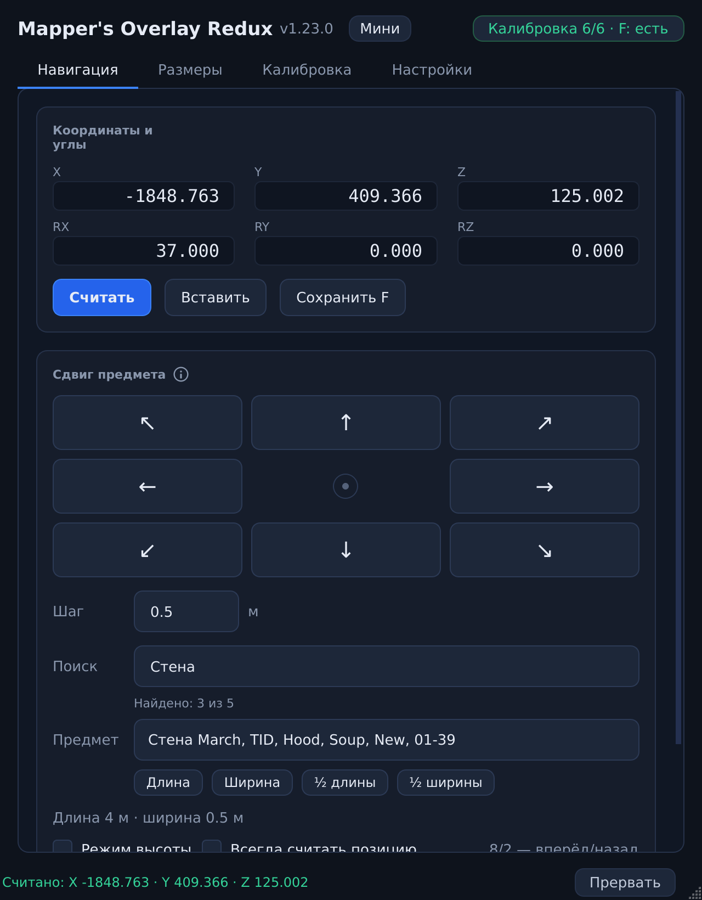
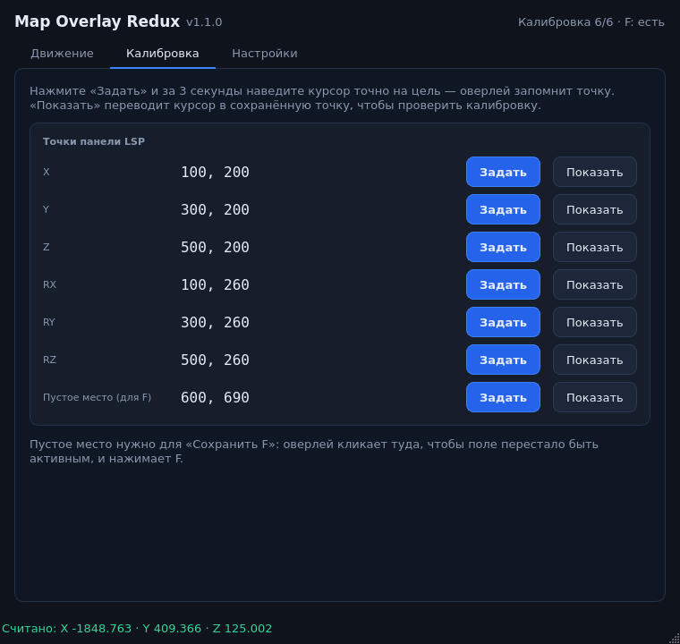
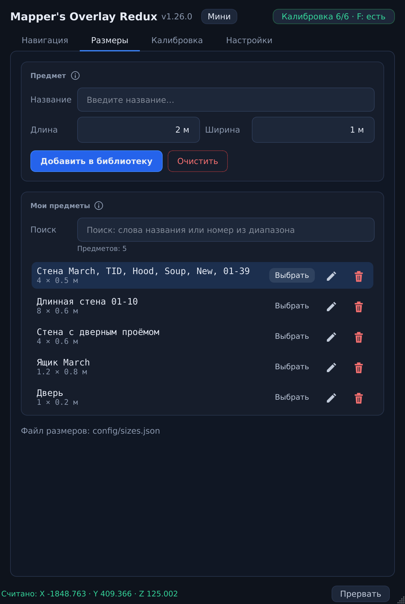
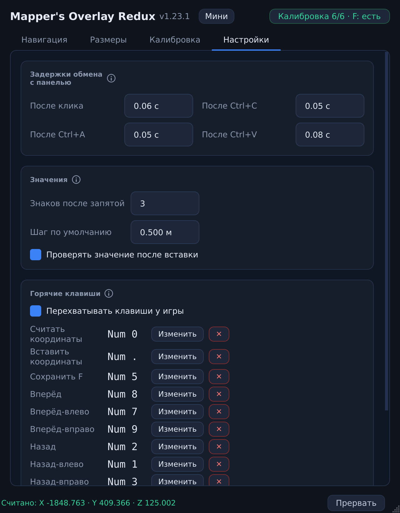

<p align="center">
  
</p>

<h1 align="center">Mapper's Overlay Redux</h1>

<p align="center">
  Оверлей для мапперов LSP (FiveM): читает позу предмета из игровой панели и двигает её
  клавишами Numpad по восьми направлениям, учитывая поворот и наклон.
</p>

<p align="center">
  
  
  
  
</p>

Версия — 1.24.3, история изменений — [CHANGELOG.md](CHANGELOG.md).

## Содержание

- [Описание](#описание)
- [Возможности](#возможности)
- [Требования](#требования)
- [Быстрый старт](#быстрый-старт)
- [Скачать готовую сборку](#скачать-готовую-сборку)
- [Использование](#использование)
- [Конфигурация](#конфигурация)
- [Если что-то не работает](#если-что-то-не-работает)
- [Безопасность](#безопасность)
- [Лицензия](#лицензия)
- [Контакты](#контакты)

## Описание

Оверлей читает позу предмета из панели LSP, двигает её клавишами Numpad по восьми
направлениям с шагом от `0.01` до `100` м и вписывает обратно только изменившиеся поля.
Кому: мапперам и администраторам серверов, которые ставят объекты в игре и устали вписывать
координаты руками. Программа работает поверх окна игры, клавиатуру у игры забирает только
на свои клавиши и возвращает её при закрытии.



Ещё экраны: [Размеры](docs/screenshot-sizes.png) · [Калибровка](docs/screenshot-calibration.png) ·
[Настройки](docs/screenshot-settings.png) · [Мини-версия](docs/screenshot-mini.png).

Четыре вкладки: **Навигация** (считать позу и двигать предмет), **Размеры** (библиотека
предметов и поиск), **Калибровка** (точки полей панели), **Настройки** (задержки, шаг по
умолчанию, горячие клавиши). Координаты и углы — поля-показания: моноширинный шрифт, цифры
выровнены по правому краю, изменить их в окне нельзя — они приходят из панели. Меняется то, что
и выглядит как поле ввода: шаг, название и габариты предмета, поиск.

## Возможности

- **Сдвиг по восьми направлениям** от считанной позы: прямые — по осям, диагонали — по наклону
  предмета (`RX`, `RY`), с доворотом на `RZ`.
- **Режим высоты** (`Alt`): `Num 8` поднимает, `Num 2` опускает по локальной оси `Z`.
- **«Прямой шаг 4/6/8/2»**: включаемая опция; при `RX`/`RY` ≠ 0 клавиши 4/6/8/2 двигают предмет
  по мировым осям, без формул поворота.
- **«Всегда считать позицию»**: перед каждым нажатием оверлей сам читает поля панели, поэтому
  «Считать» для шага не нужно.
- **Вставка позы** в другой предмет одной клавишей (`Num .`): переносятся `X`, `Y`, `Z` и углы.
- **Отмена и повтор** (`Ctrl+Z` / `Ctrl+Y`) для последних 20 шагов.
- **Библиотека размеров** с поиском по русским и английским названиям, падежам и опечаткам.
- **Шаг из габаритов**: «Длина», «Ширина», «½ длины», «½ ширины» — предмет встаёт вплотную.
- **Мини-версия** окна 380×430: крестовина, шаг, размеры предмета и переключатели режимов.
- **Проверка перед записью**: чужое значение в панели не затирается, клавиатура на время обмена
  заморожена, любое действие прерывается кнопкой «Прервать».
- **Подробный журнал** в JSON: каждая клавиша, команда и обмен с панелью — с причиной отказа.

## Требования

| Компонент | Минимум | Проверка |
| --- | --- | --- |
| Windows | 10 или 11 | `winver` |
| Python | 3.12 с [python.org](https://www.python.org/downloads/) | `python --version` |
| PySide6-Essentials и pyperclip | от 6.8 до 6.12 (не включая), от 1.9 до 2 (не включая) — ставит `run_overlay.bat` | `pip show PySide6-Essentials` |
| NumLock | включён | индикатор NumLock на клавиатуре |
| Игра | режим «окно без рамки» | настройки графики LSP |

Python при установке просит галочку «Add python.exe to PATH» — без неё `run_overlay.bat` не
найдёт интерпретатор.

## Быстрый старт

1. Скачайте папку проекта целиком (или клонируйте репозиторий) в любое место.
2. Двойной клик по `run_overlay.bat`. Первый запуск занимает 1–3 минуты: создаётся `.venv`,
   ставятся PySide6 и pyperclip. Журнал установки — `logs/setup.log`.
3. Поставьте окно оверлея так, чтобы оно **не перекрывало поля панели**: клик по закрытой
   точке попадёт в оверлей, а не в игру. Второй монитор или свободный угол — лучший вариант.
4. Вкладка **Калибровка** → «Задать» у каждого поля → за 3 секунды наведите курсор точно на
   поле панели LSP и не двигайте мышью. Нужны семь точек: `X`, `Y`, `Z`, `RX`, `RY`, `RZ` и
   **«Пустое место (для F)»** — свободный участок панели, не кнопка и не поле. Кнопка
   «Показать» переводит курсор в сохранённую точку: так видно, что калибровка не сбилась.
5. Вкладка **Навигация** → «Считать»: оверлей прочитает все шесть полей. Дальше двигайте
   предмет стрелками в окне или клавишами Numpad.

Проверка без запуска окна:

```bat
run_overlay.bat --check-only
```

Печатает версию, Python, путь к настройкам, сколько полей откалибровано, сколько предметов в
библиотеке и где лежит журнал. Полезно, если «окно не открывается»: видно, на каком шаге встало.

<details>
<summary>Ручная установка без run_overlay.bat</summary>

```bat
python -m venv .venv
.venv\Scripts\pip install -r requirements.txt
.venv\Scripts\python main.py
```

Ожидаемый результат — окно «Mapper's Overlay Redux» с открытой вкладкой «Навигация».

</details>

## Скачать готовую сборку

Готовой сборки пока нет: `.exe` не выложен, раздел Releases пуст — запускайте из исходников, как
описано в разделе [«Быстрый старт»](#быстрый-старт).

Когда сборка появится, здесь будут ссылка на релиз, размер файла, дата сборки, контрольные суммы
MD5 и SHA256 и архив с папкой `_internal`, а в Releases — сам файл. Пока этих данных нет, строки
не заполняются правдоподобными числами: «нет» значит «нет».

### Как проверить скачанный exe

```powershell
Get-FileHash .\MappersOverlayRedux.exe -Algorithm SHA256
Get-FileHash .\MappersOverlayRedux.exe -Algorithm MD5
certutil -hashfile .\MappersOverlayRedux.exe SHA256
```

Любая из трёх команд печатает хеш — он должен совпасть с суммами из раздела выше. Не совпал: файл повреждён при
скачивании или подменён, запускать его не нужно — скачайте заново и проверьте ещё раз.

## Использование

### Клавиши

| Клавиша | Действие |
| --- | --- |
| `Num 0` | Считать координаты |
| `Num .` | Вставить считанные координаты в текущий (другой) предмет |
| `Num 8` / `Num 2` | Вперёд / назад |
| `Num 4` / `Num 6` | Влево / вправо |
| `Num 7` / `Num 9` | Вверх-влево / вверх-вправо |
| `Num 1` / `Num 3` | Вниз-влево / вниз-вправо |
| `Num 5` | Сохранить F |
| `Alt` | Включить / выключить режим высоты |
| `Ctrl+Z` / `Ctrl+Y` | Отменить / повторить шаг |

- **Шаг вводится с клавиатуры.** Поле «Шаг» принимает и точку, и запятую: «1.25» и «1,25» —
  одно и то же число. После правки поле показывает число с точкой, как в журнале и в конфиге.
  Список справа от поля даёт готовые шаги (0.1, 0.25, 0.5, 1, 2, 5, 10).
- **Удержание.** Зажмите направление — шаги идут один за другим, пока клавиша не отпущена.
  Эти же правила под крестовиной записаны списком, а не абзацем.
  Пока панель занята, новый шаг не ставится: очередь не копится, предмет не «уезжает» после
  отпускания. У кнопок в окне удержания нет: один клик — один шаг.
- **Клавиши забираются у игры**: Numpad не крутит камеру и не открывает меню. `Alt` остаётся
  у системы и игры — оверлей замечает только одиночное нажатие, `Alt+Tab` и `Alt+F4` режим не
  переключают.
- **Отмена шагов работает и в игре.** `Ctrl+Z` и `Ctrl+Y` перехватываются тем же
  хуком, что и Numpad: кликать по оверлею больше не нужно. Без `Ctrl` клавиши `Z` и `Y` остаются
  игре и чату — оверлей забирает их только в сочетании. Пока окно оверлея активно, сочетания
  обрабатывает само окно: в полях ввода `Ctrl+Z` по-прежнему правит набранный текст.
- **Переназначение:** «Настройки» → «Изменить» у действия → нажать нужную клавишу. `Esc`
  отменяет, «✕» снимает привязку. Занятая клавиша забирается у прежнего действия: двух команд
  на одной клавише не бывает. Запись привязки сама отменяется через 10 секунд или когда окно
  теряет фокус.
- Если игра запущена от администратора, запустите оверлей так же: иначе Windows не отдаст хуку
  клавиши.
- Не назначайте клавиши, нужные в игре (`W`, `A`, `S`, `D`, `Space`, `Shift`, `Ctrl`, `Tab`,
  `Esc`): оверлей предупредит, но назначит — игра эту клавишу больше не получит.
- `Ctrl+Z` / `Ctrl+Y` заняты отменой и повтором шага: в игре эти сочетания до оверлея, а не до
  игры. Если в игре на них висит своё действие, снимите привязку («Настройки» → «✕» у действия) или
  переназначьте отмену на свободную клавишу — она всё равно останется с `Ctrl`.
- Оверлей показывается **без перехвата фокуса**: после запуска клавиатура остаётся у игры.
  Клик по окну оверлея фокус забирает — верните его кликом в игру.

### Направления

При `RZ = 0` действует простое правило: «вперёд» — `X` в плюс, «назад» — в минус, «влево» —
`Y` в плюс, «вправо» — в минус. Поворот `RZ` поворачивает эти направления вместе с предметом:
`+RZ` — против часовой, `−RZ` — по часовой. Углы `RX`, `RY`, `RZ` не меняются никогда.

Пример: предмет стоит в `X 1850, Y 1850, RZ 90°` и смотрит на `+Y`. Нажатие «вперёд» даёт
`Y 1855` (при шаге 5) — туда, куда предмет повёрнут. При `RZ −90°` то же «вперёд» даёт `Y 1845`.

Диагонали считаются по случаю — формулы не заменяют друг друга:

| Случай | Формула | Что видно |
| --- | --- | --- |
| наклона нет (`RX = 0`) | `ΔY = ay·шаг/√2`, `ΔZ = ax·шаг/√2`, `ΔX = 0` | 45° в плоскости экрана |
| наклонён `RX` (`RY = 0`), пара `Num 9/1` | `ΔY = ay·(шаг/√2)·sin RX`, `ΔZ = ax·(шаг/√2)·cos RX` | поворот в плоскости `Y/Z` |
| наклонён `RX` (`RY = 0`), пара `Num 7/3` | `ΔY = ay·(шаг/√2)·cos RX`, `ΔZ = ax·(шаг/√2)·sin RX` | та же плоскость, обратная тригонометрия |
| наклонены `RX` и `RY`, пара `Num 9/1` | `ΔX = ax·шаг·sin RY`, `ΔY = ay·шаг·sin RX·cos RY`, `ΔZ = ax·шаг·cos RX·cos RY` | `RY` уводит в глубину |
| наклонены `RX` и `RY`, пара `Num 7/3` | как при одном `RX`, `RY` пару не меняет | та же плоскость `Y/Z` |

Здесь `ax = ±1` — «вперёд/назад», `ay = ±1` — «влево/вправо». Если предмет наклонён, `RZ`
доворачивает готовый шаг вокруг мировой оси `Z`; без наклона диагональ от `RZ` не зависит.

Прямые клавиши (`Num 4/6/8/2`) считаются без формул наклона: влево, вправо, вперёд, назад — по
осям мира с доворотом `RZ`. Единственное место, где наклон на них влиял, — высота: там шаг идёт по
локальной оси `Z` (`ΔX = ±sin RY · шаг`). Если и высота должна идти строго по `Z`, включите
[«Прямой шаг 4/6/8/2»](#прямой-шаг-4682).


Сводка формул и эталоны с реальными числами — [docs/FORMULAS.md](docs/FORMULAS.md).
Схема и формулы считаются одним и тем же кодом (`map_overlay/domain/movement.py`).

### Всегда считать позицию

Галочка на «Навигации» рядом с «Режимом высоты» — для случаев, когда позицию предмета меняют
не только оверлеем: вручную панелью, другим инструментом или переключением предметов.

- **Что делает:** перед каждым нажатием направления оверлей сам читает все шесть полей панели
  и считает шаг от них. «Считать» (`Num 0`) для шага больше не нужно.
- **Расхождение не мешает:** если предмет подвинули в игре или в панели открыт другой предмет,
  шаг всё равно выполняется — от тех чисел, что стоят в панели сейчас. Сообщения «значение
  изменили, нажмите «Считать»» в этом режиме не бывает.
- **Удержание читает один раз:** поля читаются на нажатии, дальше шаги идут от позы, которую
  оверлей только что записал. Иначе пауза между шагами удваивалась бы.
- **Шаг идёт медленнее** примерно вдвое: чтение шести полей — ещё один обмен с панелью. Прогресс
  и «Прервать» работают как обычно.
- **Крестовина активна без «Считать»** — и в мини-версии, где кнопки «Считать» нет вовсе
  (там галочка подписана короче: «Считать позицию»).
- **Выбор запоминается** в `config/settings.json` (`always_read_pose`): включили один раз —
  режим остаётся включённым после перезапуска.
- Выключили — вернулись прежние правила: шаг от считанных координат и сверка поля `X` перед
  записью.
- **Отмена работает как всегда:** `Ctrl+Z` возвращает предмет туда, где он стоял по панели до
  шага, `Ctrl+Y` повторяет шаг.

### Режим высоты (`Alt`)

Одно нажатие `Alt` переключает режим высоты, ещё одно — выключает. То же делает галочка
«Режим высоты» на вкладке «Навигация».

- `Num 8` поднимает предмет, `Num 2` опускает — по **локальной** оси `Z`:
  `ΔX = ±sin RY · шаг`, `ΔY = 0`, `ΔZ = ±cos RY · шаг`. При `RY = 0` это шаг строго по `Z`,
  длина шага сохраняется при любом `RY`.
- Остальные клавиши не меняются: `Num 4/6` — по горизонтали с поворотом `RZ`, диагонали — по
  наклону предмета.
- С включённой опцией «Прямой шаг 4/6/8/2» высота идёт строго по мировой оси `Z`: наклон `RY`
  шаг вбок не уводит (см. [Прямой шаг 4/6/8/2](#прямой-шаг-4682)).
- **Держать `Alt` нельзя**: пока он зажат, игра не применяет правки панели к объекту, и
  значения теряются. Поэтому режим — переключатель. Привычка «`Alt` + направление» сохранена:
  такое нажатие включает режим и делает шаг.
- Режим можно переключить во время удержания — следующий шаг пойдёт по-новому.

### Прямой шаг 4/6/8/2

Включаемая галочка на «Навигации», под строкой режимов. Для случаев, когда предмет наклонён, а
двигать его нужно по осям мира — ровно так же, как при нулевых углах.

- **Клавиши 4/6/8/2 работают как обычно:** `Num 4` — влево (`Y` в плюс), `Num 6` — вправо,
  `Num 8` — вперёд (`X` в плюс), `Num 2` — назад. Формулы поворота на них больше не влияют.
- **Режим высоты (`Alt`) идёт строго по `Z`:** `Num 8` поднимает, `Num 2` опускает на весь шаг.
  Обычно высота считается по локальной оси `Z` (`ΔX = ±sin RY · шаг`), и наклонённый предмет
  уезжал вбок — с этой галочкой этого не происходит.
- **`RZ` остаётся:** это поворот предмета вокруг вертикали, и «вперёд» по-прежнему означает
  «туда, куда он смотрит». Без наклона `RX`/`RY` переключатель ничего не меняет: формулы и так не
  участвовали в движении прямых клавиш.
- **Диагонали не меняются:** `Num 7/9/1/3` считаются по формулам наклона, как описано в разделе
  [Направления](#направления).
- **Выбор запоминается** в `config/settings.json` (`straight_cardinal`) и виден при следующем
  запуске. В мини-версии подпись короче — «Прямой шаг».
- Подсказка над крестовиной при наклонённом предмете говорит, что именно сделает `Alt` в этом
  режиме: поднимет предмет строго вверх, а не вдоль наклонённой оси.

### Защита от случайного ввода

Пока оверлей работает с панелью (клик по полю, `Ctrl+A`, `Ctrl+V`), клавиатура **заморожена**:
нажатия не доходят ни до игры, ни до поля координат. Случайная клавиша не дописывает символ в
число — иначе значение перестало бы читаться, а обмен повторялся бы впустую.

- Перед кликом оверлей ждёт отпускания `Alt`, `Ctrl`, `Shift` (до 1.5 с): с зажатым `Alt`
  сочетание `Ctrl+A` уходит как `Alt+Ctrl+A`.
- Собственные клавиши оверлея (`Ctrl+A`, `Ctrl+V`, `F`) заморозка пропускает.
- Чтение поля начинается с очистки буфера: если панель не отдала значение, оверлей скажет
  «Поле `X` не отдало значение», а не покажет подставленные координаты.
- Перед записью шага поле `X` сверяется со считанным (в режиме «Всегда считать позицию»
  сверку заменяет полное чтение полей перед шагом). Если в панели другое число (вписали
  руками, вкладка «Координаты» закрыта, выбран другой предмет), шаг не выполняется и чужое
  значение не затирается: «Нажмите «Считать» и повторите».
- Заморозка снимается сама через 20 с. Если панель не ответила за 20 с, действие прерывается
  автоматически: окно и клавиатура разблокируются, в строке состояния появляется причина.
- Кнопка **«Прервать»** в правом нижнем углу бросает текущее действие, не закрывая окно.
  «Прервать» и таймаут останавливают обмен: панель видит отмену между полями и перед каждым
  кликом, поэтому лишних нажатий не уходит.
- Мышь не блокируется: «Прервать» и вкладки доступны всегда.
- Если вы двинули мышь во время обмена (это доли секунды), оверлей вернёт курсор в поле и
  продолжит — клик всегда наводится на откалиброванную точку.

### Вставка координат

Считали один предмет — поставьте второй туда же: **«Вставить»** в карточке «Координаты и углы»
или **`Num .`**.

- **Что переносится:** `X`, `Y`, `Z` и углы `RX`, `RY`, `RZ` — вся поза считанного предмета.
  Если получателю нужна только позиция, впишите углы в панели руками: оверлей их не трогает
  вне вставки и шагов.
- **Куда:** в тот предмет, который открыт в панели **сейчас**. Считать получателя заранее не
  нужно — оверлей читает его сам, чтобы `Ctrl+Z` вернул его на прежнее место.
- **`F` не нажимается:** поля заполнены, положение подтверждаете вы. Нужно сразу применить —
  нажмите «Сохранить F» (`Num 5`).
- **Отмена:** `Ctrl+Z` возвращает получателя вместе с углами, `Ctrl+Y` повторяет перенос.
- **Если получатель уже стоит там же,** панель не трогается: «писать нечего».
- **Кнопка выключена, пока координаты не считаны:** вставлять нечего. После `Num 0` она
  включается.
- Клавишу можно переназначить или снять на вкладке «Настройки» — как любую другую.

### Отмена шагов

Предмет уехал дальше, чем нужно, — **Ctrl+Z** возвращает его туда, где он стоял до шага,
**Ctrl+Y** (или **Ctrl+Shift+Z**) повторяет шаг. Помним 20 последних шагов.

Клавиши отмены слушает само окно оверлея, поэтому они работают, когда фокус у него: кликните по
окну. Пока фокус у игры, `Ctrl+Z` и `Ctrl+Y` достаются игре — это плата за то, что оверлей не
забирает клавиатуру целиком.

- **Что отменяется:** сдвиги предмета по координатам — стрелки, `Num 8/2/4/6`, диагонали
  `Num 7/9/1/3`, шаг в режиме высоты (`Alt` + `Num 8/2`) и вставка координат в другой предмет.
- **Что не отменяется:** библиотека размеров, настройки, калибровка и привязки горячих клавиш.
  Эти правки видно на экране, и они сохраняются сразу.
- **Углы не меняются:** отмена шага возвращает только `X`, `Y`, `Z`. Поворот, который вы
  сделали сами, остаётся как есть. Исключение — вставка координат: она переписывает позу
  целиком, поэтому и отменяется целиком, вместе с углами.
- **Повтор идёт от текущей позы:** тем же направлением и тем же шагом, что и отменённый.
- **Новое «Считать» очищает историю:** отменять шаги, сделанные до пересчёта позы, нельзя.
- **В полях ввода** Ctrl+Z по-прежнему правит набранный текст: опечатка в названии не отменит шаг.
- Что именно отменено, видно в строке состояния: «Отменён шаг «Вперёд» на 0.5 м.»

### Калибровка



- **«Задать»** запускает отсчёт: за три секунды наведите курсор точно на поле панели — оверлей
  запомнит точку. Нужны все шесть полей (X, Y, Z, RX, RY, RZ) и **пустое место** — туда оверлей
  кликает перед «Сохранить F», чтобы поле перестало быть активным.
- **«Показать»** переводит курсор в сохранённую точку: так проверяют, что калибровка не сбилась.
  Пока точка не задана, поле показывает прочерк, а кнопка недоступна.
- Все шесть точек и пустое место заданы — бейдж в шапке становится зелёным (**Калибровка 6/6 ·
  F: есть**). Если чего-то не хватает, он серый и показывает, сколько точек уже есть.
- Точки лежат в `config/settings.json`; перенос профиля переносит и калибровку.

### Библиотека размеров

Вкладка **Размеры**: название — отдельной строкой во всю ширину, «Длина» и «Ширина» — рядом
друг с другом, чтобы карточка не пустовала справа. Единица измерения стоит внутри поля
(«2 м»), стрелок «+» и «−» нет, дробная часть принимается и через запятую, и через точку
(`2,5` = `2.5`). Одноимённый предмет заменяется (регистр не важен), первый добавленный сразу
становится выбранным. Справка с примером — за значком ⓘ у заголовка карточки: наведением, без
блока текста под полями.



Список — строками: название (длинное переносится), а сразу под ним мелким шрифтом габариты —
`4 × 0.5 м`, `1.2 × 0.8 м`, поэтому размеры не «висят» посреди строки. Текущий предмет
подсвечен фоном на всю ширину строки. В правом краю — **«Выбрать»** (делает предмет текущим;
у выбранного он белый на подложке, у остальных — светлее обычного), **карандаш** (правка
названия и габаритов) и **корзина** (удаление): при наведении корзина белеет на красном фоне.

- **Правка** переносит название, длину и ширину в форму, главная кнопка становится «Сохранить
  изменения». Запись заменяется на своём месте; если предмет был выбран, выбор переедет на новое
  название. «Очистить» возвращает форму в режим добавления. Переименовать в занятое название
  нельзя — оверлей скажет об этом в строке состояния.
- **Шаг из размера.** На вкладке «Навигация» рядом с полем шага есть строка «Предмет» и кнопки:
  «Длина» ставит шаг равным длине предмета (следующий предмет встаёт вплотную), «Ширина» — ширине,
  «½ длины» и «½ ширины» — половине, то есть от центра до края. Кнопка просто подставляет число
  в шаг; если размер больше 100 м, она предупредит и оставит прежний шаг. Выбранный предмет сам
  шаг не навязывает.
- **Ограничения:** 200 предметов, название до 60 символов, габариты от 1 см до 1 км.
- Библиотека лежит в `config/sizes.json`, файл можно переносить между профилями. Испорченный
  файл не мешает работе: оверлей скажет об этом и запустится с пустой библиотекой.

#### Поиск по названиям

Поиск есть на обеих вкладках и работает по мере набора: наберите `Mar` — «Стена March» уже в
списке, допишете `TID` — останется только она. Каждый символ и каждое новое слово сужают выдачу.

Название можно писать «пачкой» через запятую — как предмет называют в игре, вместе с диапазоном
номеров:

```
Стена March, TID, Hood, Soup, New, 01-39
```

- **Любое слово и любая комбинация:** `Стена`, `Стена March`, `Стена Soup New`. Порядок слов и
  регистр не важны, `*` означает «дальше любое» и игнорируется.
- **Диапазон номеров:** `01-39` находится по `Стена 01`, `Стена 05`, `Стена 39`.
- **Ширина чисел важна:** `01-39`, `001-39` и `1-39` — разные диапазоны; ширина берётся из
  первого числа.
- **Если точной записи нет — сравнение по значению:** `Стена 1` найдёт `01-39` с подсказкой
  «номер совпал без учёта нулей», но при наличии точной записи найдётся она.
- **Словарь лемм** (2471 словоформа): падежи, множественное число, уменьшительные («стеночка»,
  «ящичек»), игровой жаргон («проп», «мло», «статика») и частые опечатки («палета», «стелаж»).
  `ё` и `е` не различаются: `проём` = `проем`.
- **Русское и английское название — одно и то же:** `wall` находит «Стену», `box` — «Ящик»,
  `concrete` — «Бетон». Смешанный алфавит («Cтена» с латинской `C`) не мешает.
- **Часть слова** тоже работает: `стен`, `ящ`, `палл`.
- **Точные совпадения выше:** сначала целое слово или лемма, ниже — совпадение по началу, ещё
  ниже — внутри слова; при равенстве выше название короче.
- Над списком видно «Найдено: N из M» или «Ничего не найдено по запросу «…»». На «Навигации»
  выбранный предмет остаётся в списке, даже если не подошёл под запрос, — чтобы выбор не сбивался.
- Поиск ничего не меняет в библиотеке: он только прячет строки.

### Мини-версия

Кнопка **«Мини»** рядом с названием сворачивает окно до 380×430: остаются крестовина, шаг,
размеры выбранного предмета и три переключателя режимов — «Режим высоты», «Считать позицию» и
«Прямой шаг».


- В мини-версии всегда открыта вкладка «Навигация»: это то, чем двигают предмет.
- Название программы, версия, вкладки и бейдж калибровки скрыты — в маленьком окне они
  занимали место.
- Поиск, выбор предмета и кнопки шага скрыты — они нужны, чтобы настроить шаг, а не чтобы двигать.
- Галочка «Считать позицию» (полное имя — «Всегда считать позицию») остаётся: в мини-версии
  кнопки «Считать» нет, и без неё первый шаг требовал бы развернуть окно.
- Галочка «Прямой шаг» (полное имя — «Прямой шаг 4/6/8/2») тоже остаётся и подписана короче.
  В мини-окне карточка сдвига выше окна: до нижней строки режимов доходят прокруткой.
- Кнопка меняет надпись на **«Обычный»**; нажатие возвращает прежний размер и ту вкладку, на
  которой вы были до сворачивания.
- Данные и настройки от размера окна не зависят: переключаться можно сколько угодно раз.

### Настройки



- **Задержки обмена** — после клика, `Ctrl+A`, `Ctrl+C`, `Ctrl+V`. Если панель «не успевает»,
  увеличьте их на 20–40 мс.
- **Знаков после запятой** при вставке (по умолчанию 3) и **проверка записи** после вставки
  (по умолчанию включена).
- **Шаг по умолчанию** — 0.5 м.
- **Горячие клавиши** применяются сразу, без кнопки «Сохранить».
- **«Перехватывать клавиши у игры»** — аварийный выход: снимите галочку, и перехват выключится
  мгновенно, а кнопки окна продолжат работать.
- У привязки две кнопки: **«Изменить»** назначает новую клавишу, **«✕»** (с красной обводкой)
  снимает привязку совсем. Подсказки под карточками перечислены списком, клавиши в них выделены.

## Конфигурация

Приложение настраивается файлами в `config/`; переменная окружения меняет место для них.

| Параметр | Обязателен | По умолчанию | Описание |
| --- | --- | --- | --- |
| `MAPPERS_OVERLAY_HOME` | нет | папка проекта | Где лежат `config/` и `logs/`. Прежнее имя `MAP_OVERLAY_HOME` тоже читается. |
| `default_step` | нет | `0.5` | Шаг по умолчанию, м. Допустимо от `0.01` до `100`. |
| `decimals` | нет | `3` | Знаков после запятой при записи в панель. |
| `verify_writes` | нет | `true` | Перечитывать поле после вставки и сверять значение. |
| `always_read_pose` | нет | `false` | Читать поля перед каждым шагом («Всегда считать позицию»). |
| `straight_cardinal` | нет | `false` | «Прямой шаг 4/6/8/2»: при `RX`/`RY` ≠ 0 клавиши 4/6/8/2 идут по мировым осям, высота — строго по `Z`. |
| `delays.click`, `delays.select`, `delays.copy`, `delays.paste` | нет | `0.06`, `0.05`, `0.05`, `0.08` | Паузы обмена с панелью, с. Допустимо от `0.0` до `2.0`. |
| `hotkeys.<действие>` | нет | Numpad и `Alt` | Виртуальные коды клавиш; меняются в «Настройках». |
| `calibration.<поле>`, `empty_point` | нет | — | Точки полей панели; задаются на вкладке «Калибровка». |

- Приоритет источников: `MAPPERS_OVERLAY_HOME` → `config/settings.json` → значения по умолчанию.
  Ключи командной строки меняют только вывод (`--check-only`, `--debug`), настройки они не
  переопределяют.
- Библиотека размеров — отдельный файл `config/sizes.json`, чтобы профили предметов можно было
  переносить по одному.
- Испорченный файл настроек не мешает запуску: причина попадает в строку состояния и журнал,
  приложение стартует со значениями по умолчанию.

## Если что-то не работает

<details>
<summary>Numpad не реагирует</summary>

1. **NumLock включён.** Оверлей проверяет это каждые 3 секунды и пишет предупреждение в строку
   состояния.
2. **Нажато «Считать»** — или включена галочка «Всегда считать позицию». Без координат шаг не
   с чем складывать: в статусе будет «координаты не считаны».
3. **Галочка «Перехватывать клавиши у игры»** в «Настройках» — она могла остаться снятой.
4. **Оверлей не в режиме назначения клавиши** (строка состояния просит нажать клавишу) — в этом
   режиме любое нажатие создаёт привязку, а не действие.
5. **Права совпадают:** игра от администратора требует оверлей от администратора.

Каждое нажатие видно в `logs/overlay.log` по строкам `map_overlay.action`:

```text
клавиша Num 8 нажата                  ← событие дошло до окна
клавиша Num 8 → команда «Вперёд»      ← клавиша распознана как действие
начал: шаг Вперёд 0.5 м               ← обмен с панелью пошёл
готово: шаг Вперёд 0.5 м — 640 мс     ← и закончился
```

Если действие не сработало, причина написана прямо: «шаг не начат: занято другим действием»,
«шаг не начат: координаты не считаны», «клавиша Num 8 пропущена: перехват выключен».
Нет ни одной строки про клавишу — значит, клавиша до оверлея не дошла: NumLock, права игры или
выключенный перехват.

</details>

<details>
<summary>Второй экземпляр не запускается</summary>

Так и задумано: оверлей разрешает только один запущенный экземпляр. Два экземпляра ставили бы
два хука клавиатуры — каждая клавиша приходила бы дважды, а шаги удваивались бы, причём причина
не видна: окна два, и оба выглядят рабочими.

1. При запуске второго появляется сообщение «Оверлей уже запущен», а сам он выходит с кодом 2.
2. Переключитесь на уже открытое окно: закрывать и открывать заново не нужно.
3. Проверить состояние замка без запуска окна: `run_overlay.bat --check-only` печатает строку
   «Экземпляр: не запущен» или «Экземпляр: уже запущен — второй не стартует».
4. Замок снимается сам при выходе и даже при падении — файлов и «зависших» отметок он не оставляет.

</details>

<details>
<summary>Оверлей завис</summary>

1. В строке состояния видно, сколько секунд идёт обмен с панелью. Если больше пяти — рядом
   появляется подсказка, а справа становится активной кнопка **«Прервать»**: она видна всегда,
   но подсвечивается красным только пока есть что прерывать.
2. После «Прервать» оверлей попросит «Считать» заново: после сбоя панели координаты забываются
   намеренно, чтобы шаг не пошёл от неверных чисел.
3. Если окно вообще не реагирует — закройте его (хук снимается, клавиатура возвращается игре) и
   запустите заново.
4. Пришлите два файла из `logs`: `overlay.log` (что делал оверлей) и `crash.log` (падения,
   необработанные ошибки, последние действия и стеки потоков).

</details>

<details>
<summary>В игре пропала клавиатура</summary>

1. Снимите галочку **«Перехватывать клавиши у игры»** — перехват выключается мгновенно.
2. Проверьте, не назначена ли на действие клавиша из игры (`W`, `A`, `S`, `D`, `Space`, `Shift`,
   `Ctrl`, `Tab`, `Esc`).
3. Убедитесь, что фокус у игры: клик по окну оверлея забирает его, пока вы не вернёте.
4. Худший случай — закрыть окно оверлея: при закрытии хук снимается и клавиатура полностью
   возвращается игре. Мышь при этом работает всегда.

</details>

<details>
<summary>Где лежат журналы и что в них искать</summary>

- `logs/overlay.log` — пишет подробно **всегда**, без флагов: каждая клавиша и её судьба, каждая
  команда, обмен с панелью по операциям, занятость, поза «до» и «после», результат проверки
  записи, каждый статус строки состояния и раз в 20 секунд строка «жив». Формат — JSON, одна
  запись на строку; у всех строк одного действия общий `correlation_id`. Объём ограничен:
  2 МиБ на файл и три прошлых файла.
- `logs/crash.log` — падения и зависания: блок «Последние действия оверлея» (150 событий) и стеки
  **всех** потоков.
- Что искать при зависании: **«начал» без парного «готово»** — это и есть зависшая операция;
  «Медленная операция: … — 3500 мс» — панель тормозит; «Интерфейс не отвечает N с» — интерфейс
  встал дольше 2.5 с.
- `run_overlay.bat --debug` дублирует подробности в консоль (файл и без флага пишет всё).

</details>

<details>
<summary>Можно ли перенести профиль на другой компьютер</summary>

Да. Папку проекта можно переносить целиком. В `config/` лежат `settings.json` (калибровка,
задержки, режим «Всегда считать позицию», клавиши) и `sizes.json` (библиотека размеров).
Переменная `MAPPERS_OVERLAY_HOME` меняет место для `config/` и `logs/` — так можно держать
несколько профилей калибровки.

</details>

## Безопасность

Оверлей работает локально: не открывает сетевых портов, не отправляет данные и не хранит учётных
записей. В журналах нет содержимого буфера обмена и координат мыши. Об уязвимостях не сообщайте
через публичные issue — канал и сроки описаны в [SECURITY.md](SECURITY.md).

## Лицензия

MIT — см. [LICENSE](LICENSE). Зависимости распространяются по своим лицензиям (LGPL у Qt,
BSD у pyperclip); сильного копилефта в поставке нет — это проверяет CI.

## Контакты

Вопросы и сообщения об ошибках — [GitHub Issues](https://github.com/Ven4esters/Mappers-Overlay-Redux/issues).
Шаблоны issue помогут приложить версию, шаги и журналы.
