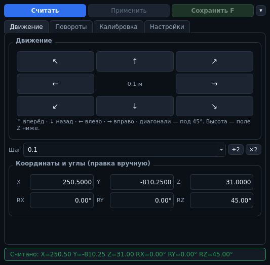

# LSP Mapper Overlay 2.0

Внутриигровой оверлей для мапперов **Los Santos Project (FiveM, GTA V)**: считает координаты
и углы пропа из левой панели редактора, считает за вас сдвиги вдоль осей предмета и
возвращает результат в игру.



## Что умеет

- **Считывает шесть полей панели** — `X`, `Y`, `Z` и `RX`, `RY`, `RZ` — через
  `Ctrl+A` → `Ctrl+C` и разбирает числа из буфера обмена.
- **Двигает проп в 8 направлениях в плане**: `↑ вперёд`, `↓ назад`, `← влево`, `→ вправо`
  и четыре диагонали под 45°. Кнопок высоты нет — `Z` задаётся вручную в поле координат
  (или стрелками в самом поле).
- **Учитывает поворот пропа.** При `RZ = 45°` кнопка «вперёд» двигает объект по двум осям
  одновременно, вдоль его собственной стены — удобно прижимать предметы друг к другу
  без зазоров. Включаются и наклоны `RX`/`RY`: движение идёт по плоскости самого предмета.
- **Позволяет задать любой угол** кнопками `±90°`/`180°`, шагом или точным числом.
- **Пишет только изменившиеся поля** и проверяет результат: если панель не приняла
  значение, прежние координаты возвращаются в поля игры, а проп остаётся на месте.
- **Подтверждает ввод так, как требует эта сборка LSP**: клик в пустое место панели и
  клавиша `F` (ADR-0003). `Enter` не используется.
- **Меряет габариты объекта рулеткой**: две точки замера — расстояние по прямой, в плане,
  перепад высоты и направление. Длина, ширина и высота записываются по отдельности,
  и длина одной кнопкой становится шагом сдвига, чтобы ставить копии вплотную (ADR-0004).
- **Ведёт таблицу предметов** с названием, длиной, шириной и высотой: поиск по названию,
  сохранение в файл, «Шаг = длина» из выбранной строки — чтобы не мерить объект заново,
  если он уже использовался (ADR-0005).

## Как это работает

1. Откройте меню пропа в игре и поставьте окно оверлея рядом (кнопка «Поверх игры» держит
   его над клиентом; в полноэкранном режиме игра перехватывает мышь, используйте
   «окно без рамки»).
2. Первый запуск: вкладка **«Калибровка»** → по очереди «Задать» для шести полей и для
   «пустого места». После нажатия есть 3 секунды, чтобы навести курсор на поле и не двигать
   мышью.
3. **«Считать»** — оверлей читает реальные координаты пропа.
4. Двигайте кнопками `↑ ↓ ← → ↖ ↗ ↙ ↘` или **Numpad**; шаг меняется в списке «Шаг»
   или кнопками `÷2`/`×2`. `↑` — это **вперёд** (вдоль оси пропа), `↓` — назад;
   высоту правьте в поле `Z`.
5. **«Применить»** вставляет изменения без подтверждения, **«Сохранить F»** — вставляет,
   кликает в пустое место панели и нажимает `F`.

Координаты можно править руками: щёлкните поле во вкладке «Движение», введите число и
нажмите `Tab`/`Enter` — при следующем применении оно уйдёт в игру. Изменённые поля
подсвечиваются жёлтой рамкой.

## Установка

Интерфейс — **PySide6**, нужен **Python 3.12** (лаунчер сам проверит версию).

Два файла на выбор:

| Файл | Что делает |
| --- | --- |
| `install.bat` | только разворачивает окружение: создаёт `.venv`, скачивает и ставит PySide6 + pyperclip, показывает версии Python и PySide6 |
| `run_mapper.bat` | делает то же, если окружения ещё нет, и сразу запускает оверлей |

```
install.bat      :: первый запуск: venv + зависимости, окно остаётся открытым
run_mapper.bat   :: обычный запуск (при необходимости докачает зависимости)
```

Оба файла — ASCII-обёртки над `tools/bootstrap.py` (журнал `logs\setup.log`). Если Python 3.12
не найден, окно консоли **не закрывается молча**: печатается причина и ссылка на python.org.
Коды выхода: `0` — успех, `2` — нет Python 3.12, `3` — не удалось создать окружение,
`4` — не удалось поставить зависимости (в том числе «PySide6 не установился»),
`5` — приложение не запустилось.

Ручной запуск из исходников:

```
py -3.12 -m venv .venv
.venv\Scripts\pip install -r requirements.txt
.venv\Scripts\python main.py
```

Полезные ключи: `--debug` (подробные логи), `--log-dir PATH`, `--check` (проверить окружение
без открытия окна), `--version`.

## Клавиши Numpad

Стрелки в игре заняты, поэтому движение продублировано на цифровой клавиатуре (NumLock включён):

| Клавиша | Что делает |
| --- | --- |
| `8` `2` `4` `6` | вперёд, назад, влево, вправо |
| `7` `9` `1` `3` | четыре диагонали под 45° |
| `5` | «Сохранить F»: вставить изменения и подтвердить |
| `Enter` | «Применить»: вставить без подтверждения |
| `0` | «Считать»: перечитать координаты из панели |
| `+` / `−` | шаг ×2 / ÷2 |

Клавиши работают, когда окно оверлея в фокусе; глобальный перехват (когда фокус в игре)
появится вместе с живым режимом движения.

## Длина объекта: рулетка


Габаритов пропа панель LSP не показывает, поэтому длина меряется положением самого пропа:

1. Поставьте проп у одного края объекта (например, у торца стены или забора) и нажмите
   **«Запомнить»** у точки `A`.
2. Переставьте проп к другому краю и нажмите **«Запомнить»** у точки `B`.
3. В таблице «Результат» появятся **длина в плане**, расстояние по прямой, перепад высоты,
   разница по осям `ΔX/ΔY/ΔZ` и направление `A → B` по компасу (`0°` — север).
4. **«Шаг = длина»** подставляет длину в плане в шаг сдвига: теперь `↑` отставляет копию
   ровно на длину объекта, и следующий проп встаёт вплотную без зазоров.

Замеры живут до перезапуска оверлея (шаг при этом сохраняется). **«Копировать»** кладёт
строку замера в буфер обмена — удобно вставить в чат или заметку.

## Таблица предметов


Габаритов у предмета три, и каждый меряется отдельно:

1. На вкладке **«Рулетка»** запомните точку `A` у одного края и точку `B` у другого.
2. В списке «Габарит» выберите, что это было — `Длина`, `Ширина` или `Высота` — и нажмите
   **«В размер»**. Длина и ширина считаются вдоль осей самого предмета, поэтому его поворот
   на 45° не портит замер; высота — по вертикали мира.
3. Повторите для остальных габаритов (каждый раз двигая проп вдоль нужной стороны).
4. На вкладке **«Объекты»** введите название и нажмите **«Сохранить»** — строка попадёт
   в таблицу.

Что умеет таблица:

- **поиск** по части названия без учёта регистра;
- **«Шаг = длина»** — ставит длину выбранного предмета шагом сдвига (так копии встают
  вплотную, а не «примерно»);
- **«Удалить»** — убирает строку;
- повторное сохранение с тем же названием **обновляет** запись, а не дублирует её.

Файл — `%APPDATA%\LSPMapperOverlay\objects.json`, рядом с настройками; переменная
`LSP_OVERLAY_CATALOG` переопределяет путь. Битый файл уходит в `objects.broken.json`,
нечитаемые записи пропускаются. Незавершённый предмет сохранить можно: неизмеренные габариты
останутся нулями.

## Защита от «улёта» пропа

Проп улетает, когда `Ctrl+A` не выделил старое значение и `Ctrl+V` дописал цифры к нему:
в поле получается мусор вроде `250.5123.45`. Против этого:

- после каждой вставки значения **перечитываются** и сравниваются с ожидаемыми
  (допуск 0.002 м и 0.05°);
- при расхождении прежние координаты **возвращаются** в поля, сохранение не нажимается;
- **лимит шага** (по умолчанию 20 м) не даёт одной командой увести объект далеко;
- при любом мусоре в поле чтение падает с понятным сообщением, а не подставляет ноль.

Всё это отключается во вкладке «Настройки» — но лучше не отключать.

## Математика движения

- Мировые оси: `+X` восток, `+Y` север, `+Z` вверх; `RZ` — против часовой, `0°` — на север.
- Локальные оси пропа: `+X` вправо, `+Y` вперёд, `+Z` вверх.
- Матрица поворота `M = Rz · Ry · Rx`, сдвиг `world = M · local`, углы нормализуются к
  `[-180°, 180°)`.
- Диагональ по умолчанию имеет длину шага (компоненты делятся на `√2`); в настройках можно
  выбрать «по шагу на каждую ось».

Подробности — в `docs/adr/0002-rotation-all-axes.md`; про замер длины —
`docs/adr/0004-izmerenie-dliny-obekta.md`.

## Структура проекта

```
main.py                    запуск из исходников
install.bat                развёртывание venv и зависимостей (PySide6)
run_mapper.bat             ASCII-обёртка над tools/bootstrap.py: установка + запуск
tools/bootstrap.py         venv, зависимости, запуск, коды ошибок
lsp_overlay/
  domain/                  чистая математика: повороты, направления, точность, защита
  application/             сценарии: сессия маппинга, запись с проверкой
  infrastructure/          Win32 SendInput, буфер обмена, панель LSP, файлы настроек и каталога
  ui/                      окно, вкладки, стили
tests/                     unit, интеграционные и дымовые тесты интерфейса
docs/adr/                  архитектурные решения
```

Слои зависят только внутрь: `ui → application → domain`, инфраструктура реализует порты
прикладного слоя. Ядро не знает ни про Qt, ни про Windows — поэтому его тесты мгновенные.

## Тесты и проверки

```
.venv\Scripts\python -m pytest            # 222 теста
.venv\Scripts\python -m pytest --cov=lsp_overlay
ruff check . && mypy lsp_overlay         # линтер и типы
```

Порог покрытия — 80 % (фактически ~88 %). UI-тесты запускаются в offscreen-режиме Qt;
если в системе нет библиотек Qt, они корректно пропускаются.

## Файлы данных

| Файл | Что внутри |
| --- | --- |
| `%APPDATA%\LSPMapperOverlay\settings.json` | шаг, паузы, калибровка, подтверждение |
| `%APPDATA%\LSPMapperOverlay\objects.json` | таблица предметов: название и три габарита |
| `logs\overlay.log` | журнал приложения (JSON, с ротацией) |

## Настройки

`%APPDATA%\LSPMapperOverlay\settings.json` (на Linux — `~/.config/...`, переменная
`LSP_OVERLAY_CONFIG` переопределяет путь). Файл версионирован; повреждённый файл
переименовывается в `settings.broken.json`, приложение стартует со значениями по умолчанию.

## Ограничения

- Ввод в игру работает через Windows `SendInput`: нужна Windows и режим «окно без рамки».
- Панель LSP читается через буфер обмена — во время чтения не переключайте окна.
- Макрос не работает, пока игра в полноэкранном эксклюзивном режиме.

## Документация

- `CONTRIBUTING.md` — правила веток, коммитов и ревью.
- `STYLEGUIDE.md` — стиль кода и обязательные проверки.
- `CHANGELOG.md` — что менялось между версиями.
- `docs/adr/` — архитектурные решения (0004 — рулетка, 0005 — таблица предметов).
- `docs/proposals/ghost-preview.md` — варианты «призрака» объекта (предложение, вариант не выбран).
