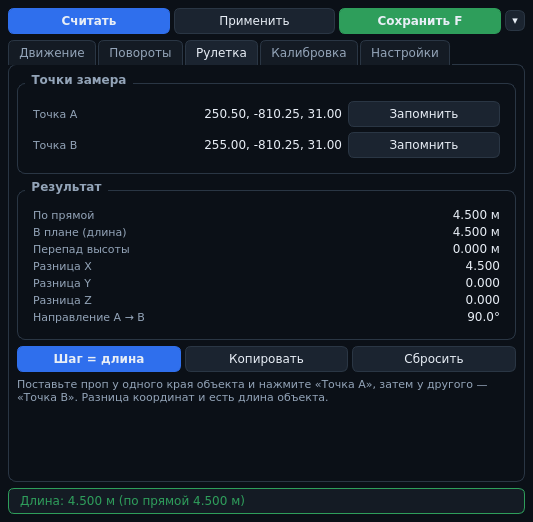
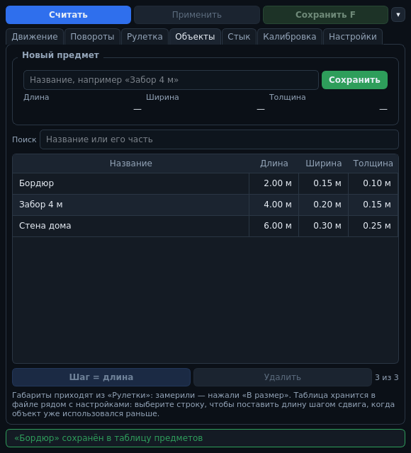
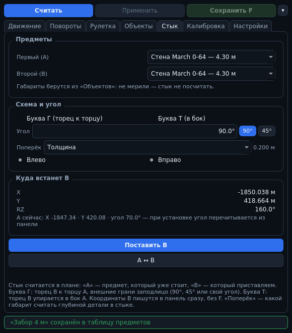

# LSP Mapper Overlay 2.0

Внутриигровой оверлей для мапперов **Los Santos Project (FiveM, GTA V)**: считает координаты
и углы пропа из левой панели редактора, считает за вас сдвиги вдоль осей предмета и
возвращает результат в игру.


## Что умеет

- **Считывает шесть полей панели** — `X`, `Y`, `Z` и `RX`, `RY`, `RZ` — через
  `Ctrl+A` → `Ctrl+C` и разбирает числа из буфера обмена.
- **Двигает проп в 8 направлениях ровно так же, как первая версия.** Шаг поворачивается на
  угол предмета `RZ` и идёт строго параллельно полу (`Z` не трогается), поэтому при
  `RZ = 70°` нажатие «влево» меняет **и `X`, и `Y`** (`ΔX −0.342 · ΔY −0.940` на метр) —
  предмет едет ровно поперёк своей стороны. `↑` — вдоль длины, `↓` — назад, плюс четыре
  диагонали под 45°. Кнопок высоты нет — `Z` задаётся вручную в поле координат.
- **Наклоны `RX`/`RY` по умолчанию не участвуют** — как в v1. Галочка «Учитывать наклоны»
  в «Настройках» включает движение по плоскости наклонённой детали, если это нужно.
- **Якорь комнаты** — базовый угол, по которому идут шаги независимо от поворота предмета:
  кнопка «Взять из предмета» под крестовиной запоминает текущий `RZ`. Пригодится, когда
  деталь поворачивают после того, как направление уже выбрано.
- **Можно двигать по сторонам света.** «Настройки» → «Оси движения» → «Мир»: тогда `↑` —
  север (`+Y`), `→` — восток (`+X`) при любом угле предмета; там же работает поправка на
  камеру (кнопки «Камера −45° / +45°»).
- **Поправки направлений** — четыре галочки в «Настройках» (`↑ вперёд`, `→ вправо`, `Z`,
  поворот): если конкретная сборка сервера зеркалит оси, направление переворачивается одним
  щелчком, без правки кода.
- **Показывает, что произойдёт и что произошло.** Под крестовиной напечатано, куда уводит
  метр: «Оси: предмет (угол 70.0°) — за 1 м: ↑ ΔX −0.94 · ΔY +0.34, ← ΔX −0.34 · ΔY −0.94»,
  а после шага в строке состояния — сколько реально прибавилось по каждой оси.
- **Позволяет задать любой угол** кнопками `±90°`/`180°`, шагом или точным числом.
- **Пишет только изменившиеся поля** и проверяет результат: если панель не приняла
  значение, прежние координаты возвращаются в поля игры, а проп остаётся на месте.
- **Подтверждает ввод так, как требует эта сборка LSP**: клик в пустое место панели и
  клавиша `F` (ADR-0003). `Enter` не используется.
- **Меряет габариты объекта рулеткой**: две точки замера — расстояние по прямой, в плане,
  перепад высоты и направление. Длина, ширина и толщина записываются по отдельности,
  и длина одной кнопкой становится шагом сдвига, чтобы ставить копии вплотную (ADR-0004).
- **Двигает копию в реальном времени** («живой режим»): копия объекта едет в игре, оригинал
  не тронут; копию можно убрать одной кнопкой (ADR-0006).
- **Ведёт таблицу предметов** с названием, длиной, шириной и толщиной: поиск по названию,
  сохранение в файл, «Шаг = длина» из выбранной строки — чтобы не мерить объект заново,
  если он уже использовался (ADR-0005).
- **Ставит второй предмет вплотную к первому** — буквой Г (90°, 45° или свой угол) или
  буквой Т: грани сходятся точно, без щели и наложения; координаты B пишутся в панель
  без подтверждения `F`, чтобы предмет только показывался (ADR-0007).

## Как это работает

1. Откройте меню пропа в игре и поставьте окно оверлея рядом (кнопка «Поверх игры» держит
   его над клиентом; в полноэкранном режиме игра перехватывает мышь, используйте
   «окно без рамки»).
2. Первый запуск: вкладка **«Калибровка»** → по очереди «Задать» для шести полей и для
   «пустого места». После нажатия есть 3 секунды, чтобы навести курсор на поле и не двигать
   мышью.
3. **«Считать»** — оверлей читает реальные координаты пропа.
4. Двигайте кнопками `↑ ↓ ← → ↖ ↗ ↙ ↘` или **Numpad**; шаг меняется в списке «Шаг»
   или кнопками `÷2`/`×2`. `↑` — это **север** (`+Y`), `↓` — юг; высоту правьте в поле `Z`.
   Под крестовиной написано, в каких осях идут стрелки, и куда сдвинулся предмет.
5. **«Применить»** вставляет изменения без подтверждения, **«Сохранить F»** — вставляет,
   кликает в пустое место панели и нажимает `F`.

Координаты можно править руками: щёлкните поле во вкладке «Движение», введите число и
нажмите `Tab`/`Enter` — при следующем применении оно уйдёт в игру. Изменённые поля
подсвечиваются жёлтой рамкой.

## Установка

Интерфейс — **PySide6**, нужен **Python 3.12** (лаунчер сам проверит версию).

Два файла на выбор:

| Файл | Что делает |
| --- | --- |
| `install.bat` | только разворачивает окружение: создаёт `.venv`, скачивает и ставит PySide6 + pyperclip, показывает версии Python и PySide6 |
| `run_mapper.bat` | делает то же, если окружения ещё нет, и сразу запускает оверлей |

```
install.bat      :: первый запуск: venv + зависимости, окно остаётся открытым
run_mapper.bat   :: обычный запуск (при необходимости докачает зависимости)
```

Оба файла — ASCII-обёртки над `tools/bootstrap.py` (журнал `logs\setup.log`). Если Python 3.12
не найден, окно консоли **не закрывается молча**: печатается причина и ссылка на python.org.
Коды выхода: `0` — успех, `2` — нет Python 3.12, `3` — не удалось создать окружение,
`4` — не удалось поставить зависимости (в том числе «PySide6 не установился»),
`5` — приложение не запустилось.

Ручной запуск из исходников:

```
py -3.12 -m venv .venv
.venv\Scripts\pip install -r requirements.txt
.venv\Scripts\python main.py
```

Полезные ключи: `--debug` (подробные логи), `--log-dir PATH`, `--check` (проверить окружение
без открытия окна), `--version`.

## Живой режим: призрак-копия

Кнопка **«Живой режим (копия)»** во вкладке «Движение» делает так, что объект двигается
в игре сразу, без «Применить»:

1. Оверлей нажимает клавишу копирования (`C`), и в игре появляется копия.
2. Копия читается как текущий объект; дальше каждое нажатие Numpad — это шаг и сразу запись
   в панель. **`F` при этом не нажимается**: значения в полях показывают, куда встанет
   предмет, но размещение не подтверждается — предмет «висит» и ничего не устанавливает.
3. Оригинал остаётся на месте: копия и есть призрак. Когда всё устраивает — нажмите
   «Живой режим» ещё раз (движение прекращается), а лишний объект уберите кнопкой
   **«Убрать копию»** (`Delete`, клавиша настраивается).

Если нужно, чтобы живой режим всё-таки ставил предмет, включите в «Настройках» галочку
**«Подтверждать F в живом режиме (ставить предмет)»** — по умолчанию она выключена.

Пока режим включён, кнопки «Считать»/«Применить» заблокированы: движением владеет поток.

Чего ждать по скорости: один шаг — это клики, `Ctrl+A`, `Ctrl+V` и проверка только тех полей,
что реально изменились (без `F` — примерно 0.2 с на шаг). Поэтому «плавно» — это маленький
шаг (`0.05` м) и непрерывная очередь шагов, а не 60 кадров в секунду.

**Движение не может «уехать» само.** Удержание клавиши ограничено тремя страховками:

- оверлей каждые 60 мс сверяет удержание с реальным состоянием клавиши — если клавиша уже
  не нажата, а событие отпускания потерялось, движение останавливается;
- если за `live_hold_timeout` секунд (по умолчанию 1 с) не было ни одного нового нажатия,
  движение тоже останавливается: при удержании Windows шлёт автоповтор, а тишина означает,
  что клавишу отпустили;
- кнопки-стрелки в оверлее в живом режиме делают **ровно один шаг** — у кнопки нет отпускания,
  поэтому удержание для неё не включается.

Если живой режим остановился сам (ошибка панели, предупреждение про мышь, предохранитель),
хук клавиатуры снимается — Numpad снова видит игра.

**Если камера крутится, а X и Y едут сами.** В 2.4.0 живой режим читал Numpad через
`GetAsyncKeyState`: клавиши видела и игра — камера вертелась, объект уезжал, проверка записи
не сходилась. В 2.4.1 Numpad на время живого режима забирает низкоуровневый хук клавиатуры:
игра этих клавиш не получает вовсе, а оверлей знает и нажатие, и отпускание. Дополнительно:

- автоповтор шага останавливается при потере фокуса окна и по таймауту 0.6 с без нажатий;
- предохранитель снимает режим после 300 шагов подряд;
- если хук поставить не удалось (не Windows или запрет системы), в журнале появится
  предупреждение, а клавиши будет видеть и игра — тогда двигайте кнопками оверлея.

**Про два окна.** Одновременно активным в Windows может быть только одно окно, и это не
проблема сама по себе. Проблема была в другом: каждый шаг макроса кликает в окно игры, фокус
уходит туда, и окно оверлея перестаёт получать клавиши. Поэтому в живом режиме зажатые
клавиши Numpad ловит низкоуровневый хук (`WH_KEYBOARD_LL`): они видны, даже когда фокус
в игре, и до клиента при этом не доходят.

Подробности — `docs/adr/0006-zhivoy-rezhim.md`.

## Клавиши Numpad

Стрелки в игре заняты, поэтому движение продублировано на цифровой клавиатуре (NumLock включён):

| Клавиша | Что делает |
| --- | --- |
| `8` `2` `4` `6` | север/вперёд, юг/назад, запад/влево, восток/вправо |
| `7` `9` `1` `3` | четыре диагонали под 45° |
| `5` | «Сохранить F»: вставить изменения и подтвердить |
| `Enter` | «Применить»: вставить без подтверждения |
| `0` | «Считать»: перечитать координаты из панели |
| `+` / `−` | шаг ×2 / ÷2 |

В обычном режиме клавиши работают, когда окно оверлея в фокусе: зажатие повторяет шаг,
а кнопка направления подсвечивается, как будто её нажали мышью. В живом режиме зажатые
клавиши читаются глобально — даже когда фокус в игре (нужен включённый NumLock).

## Длина объекта: рулетка



Габаритов пропа панель LSP не показывает, поэтому длина меряется положением самого пропа:

1. Поставьте проп у одного края объекта (например, у торца стены или забора) и нажмите
   **«Запомнить»** у точки `A`.
2. Переставьте проп к другому краю и нажмите **«Запомнить»** у точки `B`.
3. В таблице «Результат» появятся **длина в плане**, расстояние по прямой, перепад высоты,
   разница по осям `ΔX/ΔY/ΔZ` и направление `A → B` по компасу (`0°` — север).
4. **«Шаг = длина»** подставляет длину в плане в шаг сдвига: теперь `↑` отставляет копию
   ровно на длину объекта, и следующий проп встаёт вплотную без зазоров.

Под таблицей результата есть строка **«По этой линии: длина · ширина · толщина»** — видно,
каким габаритом выйдет текущий замер. Если выбран не тот габарит, запись блокируется
с объяснением: например, «Габарит «Ширина»: 0.007 м, а между точками 2.68 м — замер идёт
почти вдоль другой оси. По этой линии: длина 2.68 м · ширина 0.01 м · толщина 0.00 м».
Так в таблицу предметов не попадает ноль, из которого потом считается стык. Заодно
проверяется, что проп не поворачивали между точками `A` и `B`: длина и ширина считаются
по углам точки `A`.

Замеры живут до перезапуска оверлея (шаг при этом сохраняется). **«Копировать»** кладёт
строку замера в буфер обмена — удобно вставить в чат или заметку.

## Таблица предметов



Габаритов у предмета три, и каждый меряется отдельно: `Длина`, `Ширина` и `Толщина`
(высоты в модели нет — третье число, которое нужно мапперу, это толщина плиты или панели):

1. На вкладке **«Рулетка»** запомните точку `A` у одного края и точку `B` у другого.
2. В списке «Габарит» выберите, что это было — `Длина`, `Ширина` или `Толщина` — и нажмите
   **«В размер»**. Длина и ширина считаются вдоль осей самого предмета, поэтому его поворот
   на 45° не портит замер; толщина — по вертикали мира (проп на верхнюю и на нижнюю грань).
3. Повторите для остальных габаритов (каждый раз двигая проп вдоль нужной стороны).
4. На вкладке **«Объекты»** введите название и нажмите **«Сохранить»** — строка попадёт
   в таблицу.

Что умеет таблица:

- **поиск** по части названия без учёта регистра;
- **«Шаг = длина»** — ставит длину выбранного предмета шагом сдвига (так копии встают
  вплотную, а не «примерно»);
- **«Удалить»** — убирает строку;
- повторное сохранение с тем же названием **обновляет** запись, а не дублирует её.

Файл — `%APPDATA%\LSPMapperOverlay\objects.json`, рядом с настройками; переменная
`LSP_OVERLAY_CATALOG` переопределяет путь. Битый файл уходит в `objects.broken.json`,
нечитаемые записи пропускаются. Незавершённый предмет сохранить можно: неизмеренные габариты
останутся нулями.

## Стык: буква Г и буква Т



Вкладка **«Стык»** приставляет второй предмет к первому так, чтобы грани сошлись точно.
Считается в плане, по габаритам из таблицы предметов.

1. **A** — предмет, который уже стоит в игре; **B** — который приставляем (по умолчанию тот же).
2. Схема:
   - **Буква Г** — торец `B` к торцу `A`, внешние грани продолжают друг друга. Угол 90°
     (прямоугольный поворот), 45° (фаска) или любое своё значение от 5° до 175°.
   - **Буква Т** — торец `B` упирается в боковую грань `A` посередине.
3. Сторона: **влево** или **вправо** от оси `A`.
4. **«Поперёк»** — глубина детали в стыке: `Толщина` (по умолчанию — детали сходятся
   тонкими гранями) или `Ширина` (для плоских плит). В самом списке видны значения из
   таблицы: `Толщина · 0.150 м`, `Ширина · 2.500 м` — сразу понятно, что пойдёт в расчёт.
   Если ширина большая, а толщина не измерена, стык «по ширине» не ставится: у стены ширина
   — это высота, и вторая деталь отъехала бы на метр-другой от угла.
5. **«Поставить B»** — координаты `X`, `Y` и `RZ` уходят в панель **без `F`**: предмет только
   показывает, куда встанет, и ничего не устанавливает. Дальше `F` — если нужно закрепить.
6. **«A ↔ B»** — продолжить цепочку: базой становится второй предмет, так собирается
   поворот из нескольких деталей.

Как считается (локальные оси `A`: `X` поперёк, `Y` вдоль, `Z` вверх):

- **угол `A` учитывается целиком** (`RZ`, а также `RX`/`RY`): на карте предмет часто повёрнут
  не по осям мира — его ставят ровно по месту, и стык идёт вдоль его собственных граней;
- поза `A` берётся из последнего **«Считать»**, а не из панели в момент установки: в панели
  в этот момент выделен уже `B`, и чтение вернуло бы его координаты — стык посчитался бы от
  него (так и получалось «не у угла»); есть галочка **«Перечитывать A из панели»** для случая,
  когда `A` повернули и он действительно стоит в панели; в строке состояния видно
  `угол A 70.0° → B 160.0°`;
- если повернуть `A` после «Считать» — нажмите «Считать» снова (или включите галочку выше);
- угол `B` = угол `A` ± угол стыка (`+` влево, `−` вправо), углы нормализуются к `[-180°, 180°)`;
- опорная точка — угол `A` на выбранной стороне; через него проходят и торец, и внешняя грань
  `B`, поэтому контакт точный: `B` касается `A` и не влезает в него;
- `Z` и наклоны `RX`/`RY` копируются с `A` (при наклоне вертикальная составляющая смещения
  тоже учитывается);
- плоская стена без толщины (`0.000 м`) стыкуется **торец в торец** по своей плоскости —
  это законный вариант, о нём написано рядом с «Поперёк»;
- ширина как «поперёк» допускается только у деталей с измеренной толщиной: иначе ширина —
  это высота, и стык уезжает (см. `docs/join-across.png`);
- пишутся только изменившиеся поля, как и везде; предохранитель от «улёта» (20 м) действует.

Для буквы Т угол всегда 90°, поле угла блокируется.

Под «Куда встанет B» видно ещё две строки: **«Сдвиг от A»** в осях самого предмета
(поперёк и вдоль длины) и **«A сейчас»** с углом — по ним легко сверить расчёт с тем, что
вы ставите руками. Пример такой сверки — `docs/join-check.md`.

Подробности — `docs/adr/0007-styk-obektov.md`.

## Скорость и мышь

Пока оверлей обменивается данными с панелью, он забирает мышь: в строке состояния
появляется «не двигайте мышь», курсор становится «занятым». Если руку всё-таки положили
на мышь и курсор уехал дальше 4 пикселей — макрос **прерывается** с сообщением, чтобы число
не попало в чужое поле.

Скорость в 2.5.x выше в несколько раз:

| Действие | Было (2.4.x) | Стало (2.5.x) |
| --- | --- | --- |
| Прочитать все шесть полей | ~1.1 с | ~0.42 с |
| Записать одно поле с проверкой | ~1.4 с | ~0.18 с |
| Шаг живого режима | ~1.4 с | ~0.2 с |

Что для этого сделано:

- **паузы по умолчанию уменьшены** (клик 0.03, поле 0.04, вставка 0.04, подтверждение 0.08,
  активация окна 0.12 с) — старые настройки с прежними значениями переводятся на новые
  автоматически, ваши собственные значения не трогаются;
- **буфер обмена ждётся адаптивно**: перед `Ctrl+C` в буфер кладётся метка, и оверлей
  опрашивает его каждые 4 мс, пока не появится значение (не дольше 0.12 с) — на быстрой
  машине чтение идёт почти без пауз;
- **проверка записи читает только записанные поля**, а не всю панель: сдвиг по одной оси —
  это одно поле вместо шести;
- **сначала сравнение, потом запись**: значение сверяется с тем, что уже стоит в панели, и
  совпадающие поля не трогаются вовсе. Разница меньше 2 мм или 0.05° не вызывает ни одного
  клика, а `F` не нажимается, если писать нечего;
- **живой режим не подтверждает `F`**: предмет не устанавливается, поля лишь показывают, где
  он окажется (подтверждение включается галочкой в «Настройках»).

Если хочется ещё быстрее, паузы правятся в `settings.json` (`timings.click`, `timings.field`,
`timings.paste`, `timings.commit`, `timings.clipboard`), а страховка живого режима —
`live_hold_timeout`. Уменьшать `verify_after_paste`
не советую: именно проверка возвращает координаты, если панель не приняла вставку.

## Защита от «улёта» пропа

Проп улетает, когда `Ctrl+A` не выделил старое значение и `Ctrl+V` дописал цифры к нему:
в поле получается мусор вроде `250.5123.45`. Против этого:

- после каждой вставки значения **перечитываются** и сравниваются с ожидаемыми
  (допуск 0.002 м и 0.05°);
- при расхождении прежние координаты **возвращаются** в поля, сохранение не нажимается;
- **лимит шага** (по умолчанию 20 м) не даёт одной командой увести объект далеко;
- при любом мусоре в поле чтение падает с понятным сообщением, а не подставляет ноль.

Всё это отключается во вкладке «Настройки» — но лучше не отключать.

## Математика движения

- Мировые оси: `+X` восток, `+Y` север, `+Z` вверх; `RZ` — против часовой, `0°` — на север.
- Локальные оси пропа: `+X` вправо, `+Y` вперёд, `+Z` вверх.
- Матрица поворота `M = Rz · Ry · Rx`, сдвиг `world = M · local`, углы нормализуются к
  `[-180°, 180°)`.
- Диагональ по умолчанию имеет длину шага (компоненты делятся на `√2`); в настройках можно
  выбрать «по шагу на каждую ось».

Подробности — в `docs/adr/0002-rotation-all-axes.md`; про замер длины —
`docs/adr/0004-izmerenie-dliny-obekta.md`.

## Структура проекта

```
main.py                    запуск из исходников
install.bat                развёртывание venv и зависимостей (PySide6)
run_mapper.bat             ASCII-обёртка над tools/bootstrap.py: установка + запуск
tools/bootstrap.py         venv, зависимости, запуск, коды ошибок
lsp_overlay/
  domain/                  чистая математика: повороты, направления, точность, защита
  application/             сценарии: сессия маппинга, запись с проверкой
  infrastructure/          Win32 SendInput, буфер обмена, панель LSP, файлы настроек и каталога
  ui/                      окно, вкладки, стили
tests/                     unit, интеграционные и дымовые тесты интерфейса
docs/adr/                  архитектурные решения
```

Слои зависят только внутрь: `ui → application → domain`, инфраструктура реализует порты
прикладного слоя. Ядро не знает ни про Qt, ни про Windows — поэтому его тесты мгновенные.

## Тесты и проверки

```
.venv\Scripts\python -m pytest            # 339 тестов
.venv\Scripts\python -m pytest --cov=lsp_overlay
ruff check . && mypy lsp_overlay         # линтер и типы
```

Порог покрытия — 80 % (фактически ~86.5 %). UI-тесты запускаются в offscreen-режиме Qt;
если в системе нет библиотек Qt, они корректно пропускаются.

## Файлы данных

| Файл | Что внутри |
| --- | --- |
| `%APPDATA%\LSPMapperOverlay\settings.json` | шаг, паузы, калибровка, подтверждение |
| `%APPDATA%\LSPMapperOverlay\objects.json` | таблица предметов: название и три габарита |
| `logs\overlay.log` | журнал приложения (JSON, с ротацией) |

## Настройки

`%APPDATA%\LSPMapperOverlay\settings.json` (на Linux — `~/.config/...`, переменная
`LSP_OVERLAY_CONFIG` переопределяет путь). Файл версионирован; повреждённый файл
переименовывается в `settings.broken.json`, приложение стартует со значениями по умолчанию.

## Ограничения

- Ввод в игру работает через Windows `SendInput`: нужна Windows и режим «окно без рамки».
- Панель LSP читается через буфер обмена — во время чтения не переключайте окна.
- Макрос не работает, пока игра в полноэкранном эксклюзивном режиме.

## Документация

- `CONTRIBUTING.md` — правила веток, коммитов и ревью.
- `STYLEGUIDE.md` — стиль кода и обязательные проверки.
- `CHANGELOG.md` — что менялось между версиями.
- `docs/adr/` — архитектурные решения (0004 — рулетка, 0005 — предметы, 0006 — живой режим,
  0007 — стык объектов, 0008 — толщина вместо высоты).
- `docs/proposals/ghost-preview.md` — варианты «призрака» объекта (предложение, вариант не выбран).
