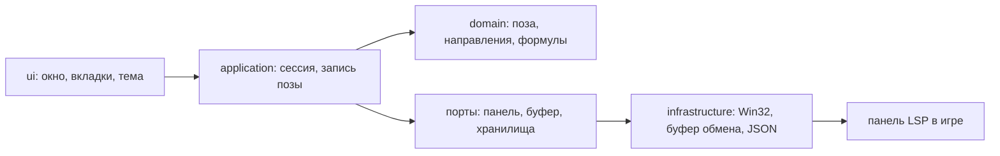

# Разработка Mapper's Overlay Redux

Всё, что нужно, чтобы собрать, проверить и выпустить оверлей. Пользователю эти сведения не нужны:
его инструкция — [README.md](../README.md).

Правила проекта и Definition of Done — [CONTRIBUTING.md](../CONTRIBUTING.md), стиль —
[STYLEGUIDE.md](../STYLEGUIDE.md), решения — [ADR](adr/), памятка по пройденным тупикам —
[LESSONS.md](LESSONS.md), исходная инструкция —
[instruction-code-style-and-checks.md](instruction-code-style-and-checks.md), история версий —
[CHANGELOG.md](../CHANGELOG.md).

## Архитектура



- **`ui`** — PySide6: окно, вкладки, тема, виджеты. Знает про `application`, не знает про Win32.
- **`application`** — сценарии: считать позу, сделать шаг, вставить, отменить. Без Qt и `ctypes`.
- **`domain`** — чистая логика: поза, направления, формулы сдвига, поиск, форматирование чисел.
- **`infrastructure`** — Win32-ввод, буфер обмена, файлы настроек и библиотеки; реализует порты.
- Зависимости идут только внутрь: `ui → application → domain`, `infrastructure → application/domain`.
  Подробности и правила слоёв — [STYLEGUIDE.md](../STYLEGUIDE.md), решения — [ADR](adr/).

## Тесты

```bash
python -m pytest                       # все тесты, без игры и без сети
python -m pytest --cov=map_overlay     # покрытие: 94 %, порог 80 % проверяет CI
ruff check . && ruff format --check .  # линтер и форматтер
mypy                                   # типы, strict
```

Тесты детерминированы: время, мышь, панель и горячие клавиши — через фейки, поэтому прогон не
зависит от игры и не «флапает». Логика формул проверяется эталонами из
[FORMULAS.md](FORMULAS.md), интерфейс — smoke-тестами на offscreen-платформе.

Формулы проверяются двумя способами, и это не дублирование:

* **эталоны** (`tests/test_movement.py`) — конкретные числа из задания заказчика: если
  `RX = 37°`, шаг 2 м даёт `ΔY = −0.851`, то так и должно быть;
* **инварианты** (`tests/test_properties.py`, `hypothesis`, 1000 примеров на инвариант) —
  правила, которые верны при любых углах: длина шага равна шагу, «вперёд» и «назад» дают
  противоположные векторы, `RZ` не меняет длину и `Z`. Эталон не заметит, если формула
  начнёт зависеть от угла, которого в задании не было; инвариант — заметит.

Интерфейс проверяется golden-тестами (`tests/test_goldens.py`): дерево виджетов и цвета темы
картинок README сравниваются с эталоном `tests/goldens/ui.json`. Подмена цвета в теме или
переименованная вкладка роняют тест с сообщением, что именно изменилось. Эталон пересобирается
одной командой — но только когда изменение интерфейса действительно нужно:

```bash
python -m tools.make_goldens    # tests/goldens/ui.json
```

Тесты, которые «ловят» сами себя, проверяются мутациями (`docs/quality/mutation.md`): `mutmut`
подменяет операторы в `domain/movement.py` и смотрит, замечают ли их тесты. Недельный job
`.github/workflows/mutation.yml` не блокирует PR — прогон идёт минуты:

```bash
PATH="$PWD/.venv/bin:$PATH" python -m mutmut run
PATH="$PWD/.venv/bin:$PATH" python -m mutmut results
```

## Разработка

```bash
python -m venv .venv
.venv/bin/pip install -e ".[dev]"
pre-commit install                     # те же проверки, что в CI, до коммита
```

Полный набор проверок — как в CI:

```bash
ruff format --check . && ruff check . && mypy \
  && bandit -q -c pyproject.toml -r map_overlay tools \
  && pytest --cov=map_overlay --cov-report=term-missing \
  && pip-audit && python -m tools.check_licenses \
  && python -m tools.check_docs && python -m tools.check_exceptions \
  && python -m tools.check_whitespace \
  && python -m build --wheel --outdir build/wheel \
  && python -m tools.make_sbom --out build/sbom.json
```

Это же проверяет CI, разложенный на шесть статусов: «Стиль и типы», «Тесты», «Безопасность»,
«Документация», «Сборка и SBOM», «Windows». Секреты в отслеживаемых файлах ищет `detect-secrets` —
он запускается через pre-commit и в CI.

Зависимости: в `pyproject.toml` и `requirements.txt` — **диапазоны** (`PySide6-Essentials>=6.8,<7`),
а точные версии для воспроизводимой сборки лежат в `requirements.lock`. Это осознанный размен
(`ADR-0049`): точный пин не пропускает патчи безопасности Qt, а без замка сборка перестаёт быть
воспроизводимой. Обновить замок после правки зависимостей:

```bash
uv pip compile pyproject.toml --extra dev --python-version 3.12 --python-platform windows \
  -o requirements.lock
```

Обновления приходят реквестами от Dependabot (еженедельно), а уязвимости в уже поставленных
версиях ищет отдельный воркфлоу `Аудит зависимостей` по расписанию: он ставит окружение из
`requirements.lock` и гоняет `pip-audit`.

Верхняя граница `PySide6-Essentials<6.12` — не перестраховка: в 6.12.0 интерпретатор падает на
завершении уже после успешных проверок (`refcount error in a C extension`, код 134; на 6.11.3 не
воспроизводится). Дефект внутри Qt-сборки, поэтому версия исключена диапазоном, а не пином: как
только выходит исправление, граница поднимается.

Картинки для документации не рисуются руками — они собираются из того же кода, что запускает
пользователь (ADR-0039):

```bash
python -m tools.make_icons        # иконка: map_overlay/data/app.ico + docs/app-icon.png
python -m tools.make_screenshots  # скриншоты вкладок, мини-версия и схема диагоналей
```

Изменили интерфейс — пересоберите картинки и закоммитьте: иначе README снова покажет старую
версию окна. Вместе с картинками обновите эталон golden-тестов
(`python -m tools.make_goldens`): без этого прогон тестов покраснеет на изменённой вкладке.
SBOM релиза собирается командой `python -m tools.make_sbom`.

### Сборка .exe

`build_exe.bat` поставит PyInstaller в `.venv`, соберёт
`dist\MappersOverlayRedux\MappersOverlayRedux.exe` по `MappersOverlayRedux.spec` и проверит, что
внутрь попали словарь лемм и иконка: без словаря поиск работал бы только по окончаниям слов,
поэтому отсутствие файла в `dist` — ошибка сборки.

- Данные сборки перечислены в `datas` внутри spec. Добавили файл данных — допишите туда же.
- Иконка exe — `map_overlay/data/app.ico`, параметр `icon` в spec. Её не рисуют вручную: файл
  собирается из рисунка в коде командой `python -m tools.make_icons`, она же обновляет
  `docs/app-icon.png` для этого README. Изменили рисунок — пересоберите файлы и закоммитьте.
- Готовый exe в репозиторий не кладётся.
- Сборка проверяется статически: PyInstaller под Windows, в CI собирается только колесо и SBOM.
- Последний шаг сборки — `python -m tools.make_exe_report`: он считает MD5 и SHA256, упаковывает
  папку в детерминированный zip (`MappersOverlayRedux_<версия>_win64.zip`) и кладёт в
  `dist\release` файлы проверки и готовый блок для раздела
  [«Скачать готовую сборку»](../README.md#скачать-готовую-сборку). Числа в README приходят из этого блока, а не
  из головы: руками суммы не переписываются.

Правила проекта и Definition of Done — [CONTRIBUTING.md](../CONTRIBUTING.md), стиль —
[STYLEGUIDE.md](../STYLEGUIDE.md), решения — [ADR](adr/), памятка по пройденным тупикам —
[docs/LESSONS.md](LESSONS.md), исходная инструкция —
[docs/instruction-code-style-and-checks.md](instruction-code-style-and-checks.md), история
версий — [CHANGELOG.md](../CHANGELOG.md).

## Roadmap

- [x] Сдвиг по восьми направлениям с учётом `RX`, `RY`, `RZ`.
- [x] Режим высоты, вставка позы, отмена и повтор шагов.
- [x] Библиотека размеров с поиском по леммам и диапазонам номеров.
- [x] Мини-версия окна и режим «Всегда считать позицию».
- [x] Опция «Прямой шаг 4/6/8/2»: прямые клавиши и высота не зависят от наклона предмета.
- [ ] Режим высоты для кнопок крестовины (сейчас он действует только на клавиши Numpad).
- [ ] Пересмотр правил стандарта и чек-листа UI — раз в квартал, по
  [политике исключений](quality/exceptions.md).

Что делать дальше и почему именно так — [docs/IMPROVEMENT-PLAN.md](IMPROVEMENT-PLAN.md):
измерения, приоритеты, волны 1.24–1.27 и метрики прогресса.

## Как принять участие

Изменения принимаются через pull request: ветка от `main`, заполненный шаблон PR (что, зачем,
как проверено, риски, откат), зелёный CI. Правила веток, коммитов и проверок —
[CONTRIBUTING.md](../CONTRIBUTING.md); отступления от стандарта фиксируются в
[политике исключений](quality/exceptions.md) с владельцем и сроком.

## Выпуск: данные для витрины

Раздел README «Скачать готовую сборку» заполняется только из файлов сборки — вручную числа не
переписываются: переписанная цифра разойдётся с файлом, и проверка у скачавших не сойдётся.

### Порядок заполнения

1. **Сборка.** `build_exe.bat` собирает `dist\MappersOverlayRedux` и сразу пишет отчёт в
   `dist\release`: `MappersOverlayRedux.exe.md5`, `MappersOverlayRedux.exe.sha256`, `MD5SUMS.txt`,
   `SHA256SUMS.txt`, `build-info.json` и готовый блок `README-exe.md`.
2. **VirusTotal.** Загрузите `MappersOverlayRedux.exe` на
   [virustotal.com](https://www.virustotal.com/gui/home/upload) и вставьте ссылку на отчёт в
   `README-exe.md` — там для неё оставлена строка `TODO`.
3. **README.** Вставьте содержимое `README-exe.md` вместо таблицы выше. Числа берутся из файла и
   руками не переписываются: переписанная цифра расходится с файлом, и проверка у скачавших не
   сходится.
4. **Релиз.** Приложите к релизу тега сам `.exe`, архив с папкой `_internal` и файлы сумм, например
   `gh release upload vX.Y.Z dist\release\MappersOverlayRedux.exe dist\release\SHA256SUMS.txt`.
