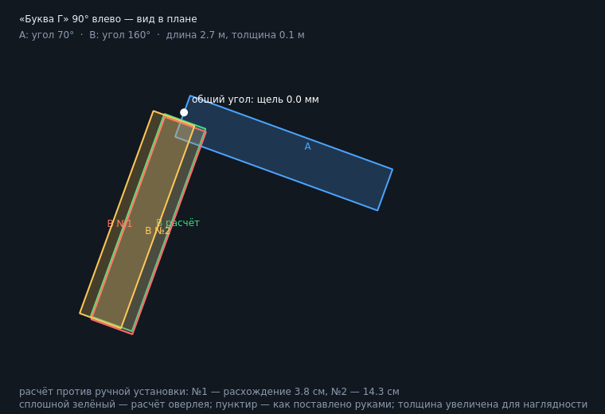

# Сверка стыка с ручной установкой

Проверка расчёта «буквы Г» на реальных координатах из игры: один и тот же предмет
поставлен руками (два раза) и посчитан оверлеем.



## Данные

| Что | Значение |
| --- | --- |
| Предмет `A` | `X −1847.342`, `Y 420.077`, `Z 128.316`, `RZ 70°` |
| Габариты предмета | длина `2.7` м, толщина `0.1` м (ширина `2.5` м — высота стены) |
| Схема | «Буква Г», 90°, влево |
| Ручной `B` №1 | `X −1849.037`, `Y 419.168`, `Z 128.316`, `RZ 160°` |
| Ручной `B` №2 | `X −1849.181`, `Y 419.243`, `Z 128.326`, `RZ 160°` |

## Расчёт

Смещение в осях `A` (поперёк, вдоль длины), `s = +1` — влево:

```
u = (−s·sin φ, cos φ)        # длина B
v = ( s·cos φ, sin φ)        # внешняя сторона B
P = (−s·t_A/2, L_A/2)        # угол A на выбранной стороне
center_B = P + (L_B/2)·u − (t_B/2)·v
```

При `φ = 90°`, `L = 2.7`, `t = 0.1`: смещение `(−1.40, 1.30)` м, то есть
`B = (−1849.042, 419.206)`, `RZ = 70° + 90° = 160°`.

## Итог сверки

| Сравнение | Расхождение |
| --- | --- |
| Расчёт против ручного `B` №1 | **3.8 см** |
| Расчёт против ручного `B` №2 | **14.3 см** |
| Угол `B` во всех случаях | `160°` — совпадает |
| Общий угол `A` и `B` | совпадает до **0.0 мм**: щели нет, наложения нет |

Ручные координаты — «примерные» (по словам автора), поэтому расхождение в сантиметрах
ожидаемо: расчёт ставит вторую деталь точно в угол первой, а не «почти».

## Насколько важен габарит

Смещение зависит от длины и толщины: при длине `4.3` вместо `2.7` вторая деталь уезжает
на `1.1` м — то есть на глаз это уже «не у угла». Поэтому в «Рулетке» габарит проверяется
перед записью (см. «По этой линии»), а во вкладке «Стык» видны поперечный размер и сдвиг.

## Почему ломалось: база стыка

Второй пример из игры — стык «буква Г» вправо для стены `2.73 × 2.50 × 0.00`:

| | `X` | `Y` | `RZ` |
| --- | --- | --- | --- |
| `A` (начальный) | `-1847.342` | `420.077` | `70°` |
| `B` (до установки) | `-1847.792` | `413.718` | `0°` |
| что получилось в 2.8.1 | `-1845.175` | `413.830` | `-90°` |
| как должно быть | `-1848.158` | `421.827` | `-20°` |

Неудачный результат — это в точности `B`, приставленный **к самому себе**: смещение
`(2.615, 0.115)` от `B` (`-1847.792 + 2.615`, `413.718 + 0.115`) и угол `0° − 90° = −90°`.
Поза `A` перед стыком читалась из панели, а в панели в этот момент выделен уже `B`.

Отсюда правило: **база — из последнего «Считать»**, панель перечитывается только по галочке.
С плоской стеной (толщина `0.000`) стык идёт торец в торец: сдвиг `1.365 м` поперёк и
`1.365 м` вдоль — половина длины в каждую сторону.
